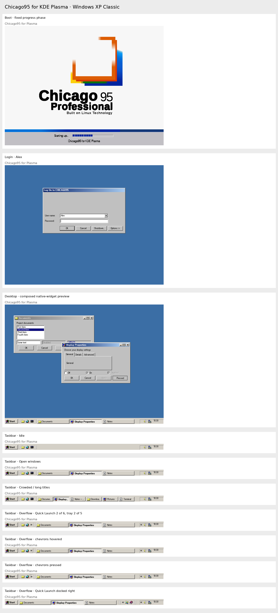
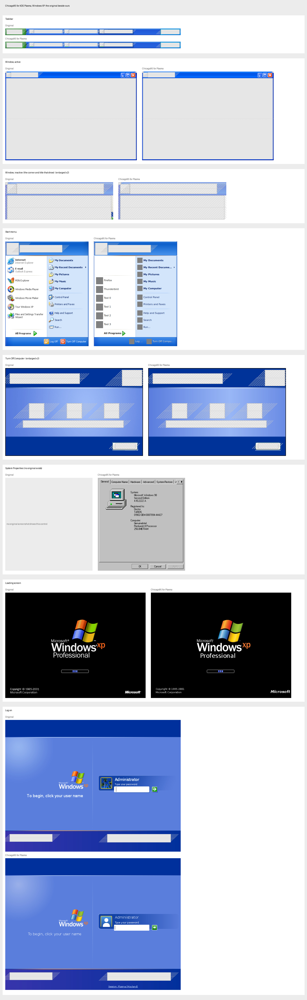
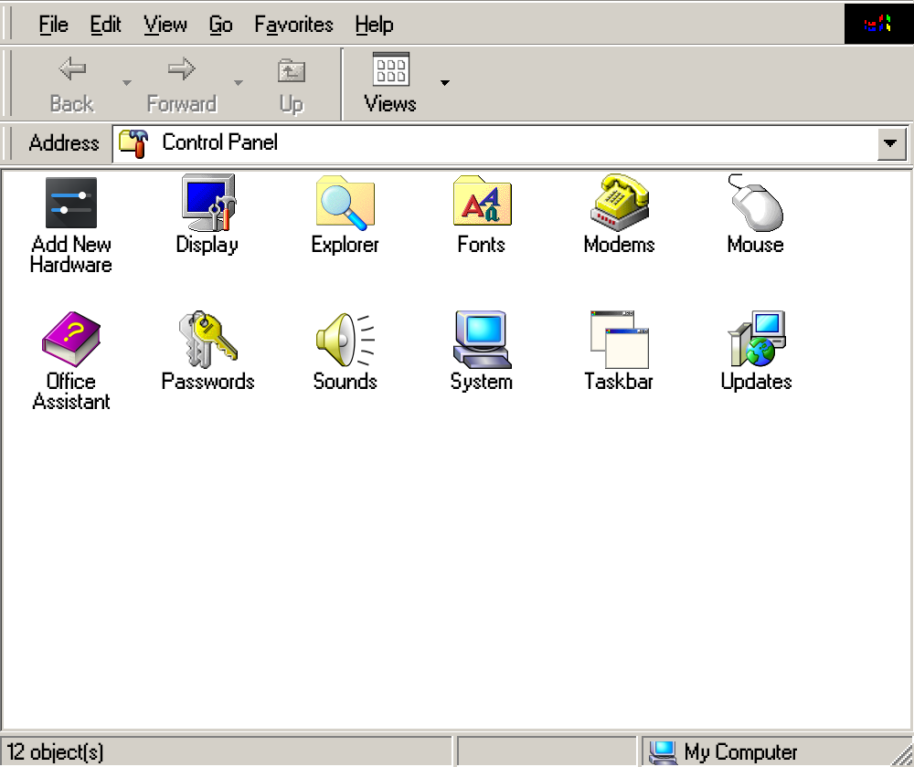

# chicago95-plasma

A classic desktop for KDE Plasma 6, inspired by Windows 95, pixel for pixel, on Wayland.


This repository holds everything Plasma-specific that sits on top of
[Chicago95](https://github.com/grassmunk/Chicago95): a generated Aurorae
window decoration, a generated Plasma style, three taskbar plasmoids, a
cascading Start menu, a classic notification daemon, Clippy, the Shut Down
dialog, a screensaver runner, and the configuration that ties it together.

The long-form write-up of how and why each piece works is the tutorial that
accompanies this repository. The README is the map; the tutorial is the
territory.

Built and tested on Fedora 44, Plasma 6.8.2 (Wayland), 3840x2160 at 1.5x.

## The five looks

Setup offers five looks: 1995, 1998, 2000, 2001 (Windows XP Classic) and Luna.
Each scenes image uses the same 800×600 boot/login/desktop scenario, followed by idle,
open-window and crowded taskbars, each with Quick Launch, tray icons and a fixed clock.
Overflow cases constrain Quick Launch to two of six entries and show two of five tray icons,
with normal, hovered and pressed chevrons plus a right-docked Quick Launch band. The desktop is a composed preview of native widgets
inside the theme's window decorations, with real icons and populated windows.
Shared boot/login designs are shown as implemented, even when multiple looks use the same design.

The separate controls sheet groups Qt Widgets, GTK3, GTK4, Plasma Qt Quick components
and Aurorae decorations by type. Available historical references appear only as component crops;
missing references take no space and do not prevent a control from being rendered.

### 1995 look


### 1998 look


### 2000 look


### 2001 look (Windows XP Classic)



### Luna look (Windows XP)



The controls of each look, beside the originals' where a screenshot shows them, are in
`docs/compare/showcase-controls-<look>.jpg`.

### Looks are presets of components

A look is a preset. It fills in the window decoration, the controls (widget style), the taskbar, the Start
menu and the login screen, and each of those can be chosen on its own in the Control Panel or with a flag, so
a 1995 desktop can have the Luna taskbar:

```
./install.sh --look=1995 --taskbar-style=luna
./install.sh --look=luna --start-menu-style=2001
```

The flags are `--decoration`, `--widget-style`, `--taskbar-style`, `--start-menu-style` and `--login-style`.
A Luna taskbar is 30 pixels high and switches Plasma's desktop theme, so tooltips and popups follow it.

## Layout

| Folder                 | Contents                                                                                                                                                                                                                                                                                                                                                                                |
| ---------------------- | --------------------------------------------------------------------------------------------------------------------------------------------------------------------------------------------------------------------------------------------------------------------------------------------------------------------------------------------------------------------------------------- |
| `aurorae/`             | `make_chicago95_aurorae.py`, `bevel.py`, Start button images, and the generated theme under `theme/`                                                                                                                                                                                                                                                                                    |
| `plasma-style/`        | `make_chicago95_plasmastyle.py` and the generated style under `theme/`                                                                                                                                                                                                                                                                                                                  |
| `luna/`                | The Windows XP Luna components: `aurorae/` decoration, `plasma-style/`, `plasmoids/` overlays (Start button, task buttons, tray box), `lib/` (widget style, Start menu, Turn Off dialog), `sddm/`, `splash/`, `plymouth/`, `palette.py`; nothing in it is shared with the flat looks (see `luna/README.md`)                                                                             |
| `plasmoids/`           | `org.chicago95.start`, `org.chicago95.tasks` (Quick Launch and task buttons), `org.chicago95.trayframe`, `org.chicago95.clock`                                                                                                                                                                                                                                                          |
| `bin/`                 | `chicago95-startmenu`, `chicago95-notifyd`, `chicago95-clippy`, `chicago95-shutdown`, `chicago95-screensaver`, `chicago95-sysprops`, `chicago95-devmgr` (Device Manager, read-only, from lshw), `chicago95-k8sview` (the Kubernetes cluster as a device tree), `chicago95-dialup`, `chicago95-deezer`, `chicago95-control-panel`, `chicago95-askpass`, `chicago95-run` (the Run dialog) |
| `lib/`                 | `chicago95ui.py`, the shared PySide6 look module                                                                                                                                                                                                                                                                                                                                        |
| `data/`                | Menu stylesheet for plasmashell, tray arrow, Clippy sprites and sounds, KRunner QML override, fastfetch preset                                                                                                                                                                                                                                                                          |
| `data/sound-themes/`   | Freedesktop sound themes for Windows 98, the 16 Plus! 98 schemes and Windows 2000, built by `setup/make_sound_themes.py`                                                                                                                                                                                                                                                                |
| `data/toolbar-icons/`  | Windows 95 and 2000 Explorer toolbar buttons (Back, Up, Cut, Copy...), installed as the `Chicago95-Toolbar` icon theme over the look's icon set; built by `setup/make_toolbar_icons.py`                                                                                                                                                                                                 |
| `config/`              | Colour scheme, KWin rules, systemd drop-in and unit, environment.d, autostart entries, Thunar, xsettingsd, GTK CSS, Dolphin toolbar, Firefox `user.js`                                                                                                                                                                                                                                  |
| `kwin-scripts/`        | `chicago95windows`, the taskbar menu's Cascade Windows, Tile Windows and Minimize All Windows with Undo, a KWin script                                                                                                                                                                                                                                                                  |
| `kwin-tabbox/`         | `chicago95`, the Alt+Tab switcher layout: the classic icon box, or window previews                                                                                                                                                                                                                                                                                                      |
| `config/desktop/`      | The desktop icons' links: My Computer, Network Neighborhood (My Network Places on 2000), Recycle Bin, My Documents                                                                                                                                                                                                                                                                      |
| `kwin-effects/`        | `chicago95notifications`, the slide-in effect; `chicago95zoom`, the title bar zoom                                                                                                                                                                                                                                                                                                      |
| `lockscreen/`          | The `contents/lockscreen` override for the Plasma desktop shell                                                                                                                                                                                                                                                                                                                         |
| `splash/`              | `chicago95.splashscreen` KSplash package                                                                                                                                                                                                                                                                                                                                                |
| `install.sh`, `setup/` | Chicago95 Setup: detection, component and option screens, install steps                                                                                                                                                                                                                                                                                                                 |
| `uninstall.sh`         | Removes what Setup installed and restores backups                                                                                                                                                                                                                                                                                                                                       |

## Requirements

KDE Plasma 6 and `git`. Setup handles the rest:

- It clones [grassmunk/Chicago95](https://github.com/grassmunk/Chicago95) to
  `~/src/Chicago95` when no checkout is found (themes, icons, cursors, sounds
  and the More Perfect DOS VGA font come from it). Point `CHICAGO95_SRC` at an
  existing checkout to reuse it.
- When Python modules are missing it shows the package command for your
  distribution and offers to run it with `sudo`. On Fedora that is:

```
sudo dnf install python3-pyside6 python3-pyxdg python3-dbus python3-gobject \
    thunar xsettingsd tumbler qmmp qmmp-plugin-pack \
    xscreensaver-extras xscreensaver-gl-extras
```

The MS W98 UI font can't be redistributed. Drop the OTF into
`~/.local/share/fonts` before running Setup, or pick another family with
`--font=`.

## Install

```
git clone https://github.com/gedaiu/chicago95-plasma ~/src/chicago95-plasma
cd ~/src/chicago95-plasma
./install.sh
```

Setup runs as a full-screen text installer in the classic
style: it collects information about the computer, lets you pick
components and options, copies files with a progress bar, and reloads
Plasma.

It detects the distribution and package manager, the Plasma version, the
primary screen's logical resolution and scale, an existing Chicago95
checkout (or clones one), the XScreenSaver hack directory, the Firefox
profile in daily use, whether Thunar and qmmp are installed, and missing
Python modules, with the install command for your distribution.

Components, each optional: Chicago95 base theme, decoration and Plasma
style, animations, taskbar plasmoids, Start menu (with the Run dialog and the keys), Shut Down dialog, notifications,
Office Assistant, extra tools, Control Panel, sound scheme, desktop background, desktop icons, Alt+Tab, screensaver, Winamp, Explorer (Thunar or
Dolphin), lock screen, splash screen, boot screen (Plymouth), login screen
(SDDM), Firefox colours. GTK programs on Wayland, Firefox among them, draw their own title
bars: the look writes its title bar colours, active and inactive, into GTK's `gtk.css` so
they match the window manager's.

Selections are the selection colour under white text everywhere: drop-down
rows, selected desktop icons and KRunner's current result (its results view is
a QML override under `data/qml`, loaded ahead of Plasma's through
`QML_IMPORT_PATH`); a row that is only under the pointer keeps black text and
gets an outline instead.

Toolbar icons in every program are grey until the pointer is over them, as
Explorer's were: KDE's icon effects for Qt programs, a GTK CSS rule for the
rest, and for Plasma's own buttons (KRunner, the tray's popups, widgets) one
file of Plasma's components module shadowed under `data/qml`; Setup links the
rest of that module from the system's copy.

Setup remembers: the components and choices of earlier runs are the defaults
of the next one (flags and the screens still change them), so a reinstall or
an update keeps your set-up with a few ENTERs.

Options are pre-filled from detection and editable on the Setup Options
screen or as flags:

| Flag                                 | Default                         | Effect                                                                                                                                                                                                                                                                                                                                                                                                                                                                                                                                 |
| ------------------------------------ | ------------------------------- | -------------------------------------------------------------------------------------------------------------------------------------------------------------------------------------------------------------------------------------------------------------------------------------------------------------------------------------------------------------------------------------------------------------------------------------------------------------------------------------------------------------------------------------- |
| `--screen=WxH@scale`                 | detected                        | Positions of Start menu, Clippy, notifications; X11 DPI                                                                                                                                                                                                                                                                                                                                                                                                                                                                                |
| `--panel=28`                         | 28                              | Taskbar height used in the window rules                                                                                                                                                                                                                                                                                                                                                                                                                                                                                                |
| `--explorer=thunar` or `dolphin`     | Thunar if installed             | Which file manager gets the Explorer setup                                                                                                                                                                                                                                                                                                                                                                                                                                                                                             |
| `--saver=deepstars`                  | deepstars                       | Screensaver, also chosen and previewed on its own Setup screen: the classics (`deepstars` Flying Through Space, `beziers` Curves and Colors, `marquee`, `qix` Mystify Your Mind, `blank`, `flowerbox`, `flyingobjects`, `maze3d`, `pipes`, `fliptext`) and `flyingtoasters`, `flurry`, `glmatrix`, `bsod`; each is an XScreenSaver hack with the options that make it look the part                                                                                                                                                    |
| `--idle=5`                           | 5                               | Minutes before the screensaver starts                                                                                                                                                                                                                                                                                                                                                                                                                                                                                                  |
| `--cursor=48`                        | 48 at fractional scale, else 32 | Cursor size                                                                                                                                                                                                                                                                                                                                                                                                                                                                                                                            |
| `--clippy=yes` or `no`               | yes                             | Start the Office Assistant at login                                                                                                                                                                                                                                                                                                                                                                                                                                                                                                    |
| `--quick-launch=yes`, `no` or `auto` | auto                            | Show the Quick Launch (program shortcuts beside Start) on the taskbar; auto shows it from the 1998 look on, as the originals did. Right-click a task to add its program, right-click a shortcut to remove it, or drop programs on it. Drag the separator at its docked edge to carry it to the other end of the taskbar, beside Start or before the tray; drag the separator facing the task buttons to size it, and a chevron lists the shortcuts that do not fit. Drag a task button or a shortcut along the taskbar to reorder them |
| `--task-button-width=160`            | the look's own                  | Longest a window's button on the taskbar may be, in pixels                                                                                                                                                                                                                                                                                                                                                                                                                                                                             |
| `--settings=FILE`                    | none                            | Choices saved by the Control Panel (`KEY=value` lines, never executed), applied over the defaults; Setup saves its own choices to `~/.config/chicago95/setup.conf`                                                                                                                                                                                                                                                                                                                                                                     |
| `--font="MS W98 UI"`                 | MS W98 UI                       | UI font family, applied if installed                                                                                                                                                                                                                                                                                                                                                                                                                                                                                                   |
| `--font-scope=everywhere`            | everywhere                      | Where the UI font goes: `everywhere` (all programs, also web pages that ask for the system font), `desktop` (window title bars only) or `none`; Setup asks when the flag is missing. The Start menu, notifications, Clippy, Shut Down and the login screen always use it                                                                                                                                                                                                                                                               |

### Control Panel



`chicago95-control-panel` (Start, Settings, Control Panel, or Properties in the
right-click menu of the Start button and the taskbar) is one Windows 98
Explorer-style window for every choice Setup asks and more. It covers colours,
icons, the desktop background, the screensaver with Preview, the taskbar, Quick
Launch, the Start button and menu, the login screen, the booting screen, sounds,
fonts, the mouse and the file manager, most with live previews. Booting Screen
picks the start-up screen on its own: the classic picture or the 2000 page with
its progress bar, whatever the login style; it is `BOOT_STYLE` in `setup.conf`
and `--boot-style=classic|2000|luna` for Setup. After log on, while Plasma
starts, the loading screen follows the login instead, as the originals did: the
desktop's colour under the hourglass pointer for 9x and 2000 logins, XP's Welcome
screen with "Loading your personal settings..." for the Welcome login. KWin's
log on fade (Effects, "Log on and log off") then fades it into the desktop.
Distro Setup holds every name, text and logo the screens show (the Start button
and menu, the log on, boot and loading screens, the Shut Down dialog) on one page,
with a preview of each screen; the pages they come from keep their own fields, and
an Apply on either shows on the other. Its "Use this computer's system" button
fills them from the running distribution (`/etc/os-release` and its logo icon),
as Setup's `--branding=distro` does; Setup asks the same question once, with the
detected system first, and `--branding=windows` keeps the look's Windows names.
Display opens its own
Display Properties window with the original's tabs, and its Effects tab picks the
animation of each event with a speed slider from Off to Slow. Classic sets every
list to what the look's Windows did, and the choices live in `setup/animations.conf`.

Back, Forward, Up and the clickable address bar move between pages, and only one
window runs at a time. The panel saves `~/.config/chicago95/setup.conf` and runs
Setup again for only what changed. Its Updates page compares the installed
version with the published one and offers Check now and Install update. Clippy
runs the same check once a day after login and says so in a balloon when a newer
version is out.

Other modes: `--yes` takes every default without questions,
`--components base,look,taskbar` installs only those, `--dry-run` writes
nothing and logs every action, `--plain` replaces the full-screen UI with
plain output.

Setup starts with an intro screen, waits for ENTER (Next) on every page
and lists each file as it copies it. When Chicago95 is already installed it
offers Reinstall, Uninstall or Exit.

Every file Setup replaces is backed up to
`~/.local/share/chicago95/backup-<date>/`, and every file it writes is
listed in `~/.local/share/chicago95/installed-files.txt`. A reinstall adds
to that list and never backs up a file Setup wrote itself, so the backups
always hold your originals. `./uninstall.sh` reads the list, removes the
files and window rules, restores the oldest backup of each file and
switches Plasma back to Breeze. Window rules are merged into an existing
`~/.config/kwinrulesrc` as text, so your own rules are kept.

At the end Setup offers to replace your panels with the Chicago95 taskbar
(the old layout is backed up) and to log out, which the autostart entries
need. It does neither without a yes.

The screensaver runs from Plasma's power management
(`~/.config/powerdevilrc`, "Run script" after the idle time), because
Wayland does not give the idle time to ordinary programs. Any key, click or
mouse movement ends it.

The "Boot screen" and "Login screen" components ask for the administrator
password on the Setup screen and list the exact commands first. The boot
screen copies `~/src/Chicago95/Plymouth/Chicago95` and rebuilds the boot
image with `plymouth-set-default-theme -R`; with the 2000 boot style it
instead renders our 2000 loading screen at the monitor's size
(`bin/chicago95-splash-image`) and installs it as `Chicago95-2000`, a
Plymouth script theme (`plymouth/Chicago95-2000`) that fills in the progress
blocks as the system boots. Uninstall switches back to the previous theme.

The "Login screen" component asks for the administrator password on the
Setup screen, installs the Chicago95 log on dialog from `sddm/Chicago95Plasma` (with the UI font, which the greeter cannot read from your home) and
writes `/etc/sddm.conf.d/zz-chicago95.conf`. SDDM reads that folder in name
order and the last file wins, so the `zz-` name beats a leftover theme
setting from another file there. Both are off with `--yes`; ask for them with
`--components=plymouth,sddm`.

## Desktop, keys, Alt+Tab and the taskbar's menu

The desktop icons are links in `~/Desktop` (My Computer, Network Neighborhood, Recycle Bin, and My Documents
from the 1998 look on), shown by Plasma's Folder View at the originals' 32px with two label lines; Display
Properties > Effects picks the set. Folder View's rows are 90px apart where the originals' were 75, and its
labels keep their shadow.

The originals' keys: the Windows key alone and Ctrl+Esc open the Start menu, Win+R the Run dialog, Win+E Explorer,
Win+D and Win+M show the desktop, Win+F Find. They are service shortcuts in `kglobalshortcutsrc` and take effect
at the next login (Setup offers to log out). The Run dialog is the 1995 original's, pixel for pixel
(`tests/test_run_reference.py`), with a twist: as you type, programs, commands on the PATH, folders and files that
match are listed under the field; Enter runs the first, or the typed line as it is.

Alt+Tab is our KWin switcher layout, measured from a Windows 95 capture (`tests/references/win95alttab.png`): a
379px grey box with the windows' icons in 48px cells, seven to a row and further rows below, the chosen one in a
1px navy frame, and its title in bold in a sunken field under them. Taskbar > Taskbar Options' "Window previews"
(Off, Small, Medium, Large) switches both it and the task buttons' tooltips to live previews of the windows at
that width; the tooltips are otherwise the flat pale yellow title.

A right-click on the taskbar offers the Quick Launch, Cascade Windows, Tile Windows Horizontally, Tile Windows
Vertically, Minimize All Windows, the Undo of the last of those, and Properties. The arrangements are a KWin
script (`kwin-scripts/chicago95windows`) measured from the Windows 98 originals: Cascade steps 22 right and 21
down with every window seven eighths of what is left; Tile splits the work area into equal columns or rows, a grid
past four windows.

## Resolution

Wayland does not let clients position their own windows, so the Start
menu, Clippy and the notification column are placed by KWin rules that
Setup computes from the screen size and taskbar height. After a
resolution change, rerun
`./install.sh --components startmenu,notifications,clippy`.

## Fractional scaling

At 1.5x the pixel font is crisp only at integer device sizes, which is why
the tools pin 10 px, and X11 apps need `Xft.dpi: 144` in `~/.Xresources`
and `forceFontDPI=144` in `~/.config/kcmfonts` with no `QT_SCALE_FACTOR`
anywhere. At 1x or 2x the DPI section of the tutorial can be skipped.

## Linting and formatting

`make check` verifies formatting and lints every source file without changing anything; CI runs it. `make format` rewrites the files into the house style.

| Files                               | Tools                                                                                                  |
| ----------------------------------- | ------------------------------------------------------------------------------------------------------ |
| Python, including `bin/chicago95-*` | ruff (settings in `pyproject.toml`, line length 120)                                                   |
| Shell                               | shfmt and shellcheck                                                                                   |
| QML                                 | qmlformat and qmllint, from `pyside6-*`                                                                |
| JS                                  | eslint with `@re-cinq/eslint-plugin-re-lint` (it also adds blank lines for readability), then prettier |
| JSON, YAML, CSS, Markdown           | prettier, run through `npx`                                                                            |
| XML, `.desktop`                     | xmllint, desktop-file-validate                                                                         |

`pip install --user -r requirements-dev.txt` brings ruff, shellcheck and shfmt, and `npm ci` the JavaScript tooling (`make` does that itself). A tool that is missing is skipped locally and is an error in CI. SVG files are generated and left alone. The KDE-derived `lockscreen/` and `data/qml/` QML is formatted but not linted, and qmllint only gates on every message when the Plasma QML modules are installed.

## Tests

```
pip install --user -r requirements-dev.txt
python3 -m pytest tests
```

Control Panel → Passwords → Log On → **Test Luna startup flow…** rehearses boot,
user selection, wrong passwords, loading, desktop fade, switching users and logoff.
Use dummy passwords. **Hold loading screen** tests delayed readiness; **Continue**
releases it. **Run scenario** records a failed attempt followed by successful logins,
two user switches, logoff, another login and shutdown. **Shut down** and **Reboot**
rehearse the status-screen sequence without requesting a real power action. Choose an output folder for timestamped PNG frames,
`events.json`, and `flow.mp4` (requires ffmpeg). The desktop is a Spectacle snapshot;
the UI test uses the actual QML screens with simulated authentication and a preview fade.

For native startup integration and an automated recording, run:

```sh
python3 tests/record_login_flow.py --output /tmp/luna-flow-run
```

The destination must be new. The runner installs Luna in a disposable home and runs
an isolated KWin/Plasma session. It checks first-frame ordering, failed/successful
mock authentication, real KSplash startup, Plasma desktop/panel readiness, and the
actual KWin login fade, including an intermediate frame. Plasma supplies KSplash's
final desktop stage. Results are in `integration.json`, screenshots/logs, and
`recording/flow.mp4`; recording timestamps preserve capture delays. It does not change
the current desktop, authenticate accounts, or reboot. Dependencies are those of the
native desktop tests below, plus `ksplashqml` and ffmpeg.

**Booting Screen → Test boot sequence…** rehearses an optional text loader before
the graphical boot screen. The text-loader preview fills over 2.5 seconds by default;
this timing is adjustable in the QML and is not a measured boot duration. It does not
emulate firmware, run DOS, or alter the installed Plymouth sequence.

With the Windows 2000 login style, the installed post-login splash displays a
“Please wait” dialog. Its text follows actual KSplash session stages; it stays up
until the session completes instead of playing timed network/service messages.
Individual systemd unit reporting is not connected yet. The current banner variant
differs from the supplied video's; visual tests explicitly exclude that artwork.

For 1995, 1998, 2000 and 2001, **Distro Setup → Names and Logos → Shut Down**
has **Test shutdown…** and **Test logoff…** buttons. They use the unapplied preview
settings and always pass `--dry-run`: no session or power command runs. The classic dry run prints the requested command and exits. Action options and confirmation
buttons provide tooltips; combo-box help follows the selected action.

```sh
python3 tests/record_classic_power_flows.py --output /tmp/classic-power-review
```

This runs all supported action/cancellation paths with backend commands intercepted,
checks tooltip display and saves per-theme PNG captures and MP4 review reels. Reels
hold each capture for one second; they are not recordings of native animation timing.
The session app never announces that power is safe to cut: it cannot observe completion
after its own session ends. Real shutdown is handed to the system. Passing these
behavior tests does not establish original-OS shutdown-screen fidelity.

Video-reference visual regressions run with:

```sh
python3 -m pytest tests/luna/test_luna_video_flow.py tests/test_login_flow.py
python3 -m pytest tests/test_boot_visual_states.py tests/test_text_boot.py tests/test_loading_screen_reference.py
```

Boot checks cover empty/quarter/half/full loader bars at three resolutions, black
side margins, removal of the text overlay, uncompressed banner artwork and visible
status updates. Each comparison retains actual, expected and difference PNGs.

These compare welcome, logoff and shutdown renders against frames from the reference
video, check logo placement locally, and test fixed control dimensions at three
resolutions. Failed image comparisons retain actual, masked-reference and difference
PNGs in pytest's temporary directory. Text and account photos are explicitly masked
in full-frame comparisons because installed fonts and user pictures vary; separate
assertions check captions, alignment, avatar size and loading-state styling. Passing
these checks does not establish pixel-perfect font rendering or animation timing.

This is not a firmware/Plymouth/PAM integration test or proof of XP animation timing.
The native session uses the test account; account switching is simulated separately.
If these checks pass but installed startup still fails, reproduce it in a disposable
VM with a real boot and SDDM login before changing transition timings.

`tests/test_startmenu_reference.py` renders the Start menu at 1x and compares it with a
screenshot of the 1995 original:
size, bevel, separator, highlight, arrows and text positions must match; outside the icons and
the letter shapes, not a pixel may differ. The screenshots are in `tests/references` (sources in `SOURCES.md` there).

`tests/test_plasma_taskbar_reference.py`, `tests/test_plasma_window_reference.py` and `tests/test_plasma_desktop_reference.py` run the real
desktop: Setup installs into a throwaway home, then KWin and plasmashell run headless at 640x480 (800x600 for 2001 and Luna) with
each original's windows (Qt, GTK 3, GTK 4 and X11), Quick Launch entries and tray icons, and the
screenshot is compared with the original's taskbar and windows. They need KWin, plasmashell, spectacle,
Xwayland, xmessage and the MS W98 UI font, and are skipped without them; each look takes about 25 seconds.

`tests/luna/` tests the Luna components against the `xp*.png` references: the palette, the decoration, the
Plasma style and taskbar QML, the widget style, the Start menu, the Turn Off dialog, the log-on, splash and
Plymouth screens, and `test_flat_looks_unchanged.py`, which pins the flat looks' files byte for byte.

`python3 tests/render_report.py docs/compare [LOOK ...]` writes two images per look
(1995, 1998, 2000, 2001, luna):

- `showcase-<look>.jpg`: boot, login, a populated desktop preview, and seven taskbar variants, including overflow and chevron states.
- `showcase-controls-<look>.jpg`: controls grouped by type and labelled by toolkit and state.
  Each type has its own section with Qt, GTK3 and GTK4 examples together; scrollbars,
  sliders and progress bars have separate sections.
  Coverage includes buttons, checkboxes, radios, text and numeric fields, date/time editors,
  sliders, scrollbars, progress bars, tabs, lists, trees, tables, menus, toolbars, splitters,
  labels, window decorations and taskbars. Every look uses the same Qt catalogue in
  `controls_gallery.py`; GTK3 and GTK4 use `tests/gtk_showcase.py` in separate processes.

Scenes and controls render independently of reference screenshots. Missing reference files are
omitted. GTK rendering needs PyGObject, the corresponding GTK runtimes, KWin and D-Bus;
it runs in a disposable home and compositor session. Missing optional runtimes/assets are
reported on stdout, while rendering failures stop generation. Classic boot previews need the
upstream Chicago95 Plymouth assets (`CHICAGO95_SRC`, default `~/src/Chicago95`).
Qt Quick rendering requires the KDE KSvg and Kirigami QML modules.

Visual consistency checks:

- `python3 -m pytest tests/test_control_consistency.py -q` compares equivalent native,
  gallery and Control Panel controls for every OS look: buttons, checkboxes, radios,
  inputs, combos, spin boxes, sliders, and both scrollbar orientations. It checks
  normal, disabled, selected/mixed, hover, pressed and keyboard-focus states where
  applicable, including separate arrow and thumb states. Failures save expected,
  actual and difference PNGs in the test output directory.
- `python3 -m pytest tests/luna/test_luna_gtk_visual_consistency.py -q` renders GTK3/GTK4
  in isolated KWin sessions. It compares Luna checkbox pixels, radio interiors and
  dimensions, state changes, and Qt/GTK check marks. Checkbox comparisons are exact;
  radio interiors allow 2/255 channel rounding for antialiased hover glows. This is
  targeted cross-toolkit coverage, not a claim that every Qt/GTK widget is pixel-identical.
  It also compares classic and Luna tab borders with the first/second page selected
  and with disabled tabs, on all four sides. Fixed label boxes isolate borders from
  font rasterisation. Classic allows narrowly bounded bitmap-corner antialiasing,
  but rejects a border through the selected tab; Luna allows 2/255 corner antialiasing. The classic GTK4 override reuses
  the installed GTK3 notebook assets and is removed from the imports when switching to Luna.
  Qt and GTK previews use the same 11px interface font. GTK receives Qt's resolved font
  family so missing-font fallbacks also match; native font metadata verifies this.
  Progress bars are compared at 0%, 1%, 55% and 100%, disabled, reversed and RTL,
  horizontally and vertically. Checks require visible, increasing fill as well as
  matching pixels. Both classic GTK versions share the installed progress CSS;
  Luna explicitly sizes and segments the fill in both orientations.
  Group boxes compare a single border, fixed label space and child alignment in
  labelled, disabled and unlabelled cases. The showcase shows real labels and keeps
  group boxes in their own section, separate from switches.
  Dropdowns and spin boxes compare geometry, borders, arrow artwork and text placement
  in normal, disabled, hovered and pressed states. Smooth-font glyph antialiasing is
  excluded from the pixel comparison; glyph bounds and surrounding pixels are checked.
  Qt's Luna spin buttons also check for an uninterrupted surface between the arrows.
  Luna progress bars compare Qt/GTK3/GTK4 thickness, white inset and chunk pixels
  across fill levels, disabled, reversed and RTL states. Qt widget checks also
  require readable black labels and consistent sizing with or without text.
  Classic GTK controls and bitmap assets follow the active window/selection scheme;
  native palette checks cover Windows 2000 and XP Classic, including disabled inputs.
  Luna top-tab artwork is compared directly with Qt, including all three orange
  accent rows, inactive/hover gradients and the open selected-tab seam. GTK tab
  comparisons cover all four positions and selection, disabled and hover states.
  Luna GTK switches compare both positions across normal, disabled, hover, pressed
  and keyboard-focus states, including marks, thumb placement and visible feedback.
  Luna sliders use green-capped rectangular thumbs without marks and pointed
  thumbs facing a single row of tick marks, as in the XP screen-resolution control.
  Tests also require visible ticks, the pointed silhouette and a single grey track
  without a white highlight.
  Luna sliders compare Qt/GTK3/GTK4 thumb pixels in both orientations, including
  hover, pressed, disabled and endpoint states. They require a smooth gradient and
  compare GTK track geometry and thumb placement.
  Scrollbars compare bar/thumb geometry and end-arrow artwork, including disabled,
  hover and pressed thumbs. Luna grip checks independently require four dark ridges
  and four highlights, centred in horizontal and vertical thumbs, so two missing
  textures cannot pass just by matching each other. **GTK4 removed native stepper buttons:** its end arrows
  are decorative CSS artwork, not clickable controls, and cannot individually disable
  at the adjustment limits. GTK3 retains working steppers. The showcase labels this
  distinction; restoring functional GTK4 steppers requires application/toolkit changes.
- `tests/test_showcase.py` checks asset loading and taskbar geometry, including the
  narrower tray without a chevron and the 2001 login banner and boot logo.

Add `--details` to also generate `report-<look>-<part>.png` and `.txt` historical pixel
comparisons. Those diagnostic reports still require their reference screenshots and use the
original test scenes, masks and pixel differences.

## Credits

Chicago95 by grassmunk and contributors (GPL-3.0) for the theme, icons,
cursors, sounds, Plymouth and SDDM themes. React Plus as the starting copy
for the Plasma style. ClippyJS for the Office Assistant sprite data.
Nullsoft's Winamp 2.91 base skin, played by qmmp. XScreenSaver by Jamie
Zawinski. The Windows 98, Plus! 98 and Windows 2000 (remastered) sound
schemes are Microsoft's; they are converted to Ogg for the sound themes.

## Licence

GPL-3.0, matching Chicago95, whose artwork the generated files derive from.
See `LICENSE`.

HD Clippy artwork is in `data/clippy/hd-animations`: 496×372 transparent frames
at four times the original logical resolution, with 22 playable sequences.
The set includes four gaze directions, four pointing directions, eyebrow raise,
wave, greeting/goodbye, thinking, head scratch, celebration, writing, reading,
sleep/wake, snoozing, blink and rest. Gaze and blink composite eye layers onto
one fixed master to prevent body/paper movement.

Open an independent preview and right-click **HD animations** to select a clip:

```sh
python3 bin/chicago95-clippy --artwork hd --preview --mute
```

The original complete atlas remains the default. HD is a new keyframe set, not
an exact redraw of all 43 original clips. Each gesture group has four drawn poses;
greeting/goodbye share wave artwork, and wake reverses the sleep poses. The
manifest explicitly lists reused clips for assistant events such as Hide and Alert.
The installer includes the pack; `--artwork hd` also works after installation.
It copies only playback assets, excluding Blender files, generated source sheets
and review videos from the installed assistant directory.
Generated source sheets and the exact built-in image-generation prompts are
recorded in `data/clippy/hd-sources/provenance.json`.

```sh
python3 -m pytest tests/test_clippy_hd.py tests/test_clippy_hd_pack.py
python3 tests/render_clippy_hd_pack.py --output /tmp/clippy-hd-review
python3 tests/audit_clippy_hd_edges.py --output /tmp/clippy-hd-edges
```

The renderer saves a combined `all-animations.mp4`, individual clips, a contact
sheet, every keyframe, and timing metadata. Recordings show both large and normal
sizes. The output directory must be new. Add `--build` to rebuild the checked-in
pack from its source sheets. The pack includes the blink study; the redundant
standalone blink export and renderer have been removed.

The edge audit renders every frame on white, dark and magenta backgrounds and
fails if alpha above 8/255 remains more than two physical pixels outside the
solid silhouette, or if fully transparent pixels retain RGB residue. The build
uses deterministic alpha cleanup, preserving visible RGB colors and contour
antialiasing. This catches background haze that a teal-only preview hides;
it does not certify pose consistency or smooth motion. Corrected pointing poses
and their generation prompt are in `data/clippy/hd-sources/corrected-poses`.

The separate **3D calibration prototype** uses Fog's downloaded Clippy model,
retained with attribution in `data/clippy/3d-prototype/provenance.json`. It adjusts
the paper and metal materials, repairs the paper texture, replaces the missing
environment with controlled lights, and exercises the model's existing eyelid
and wire rig. `tests/clippy_3d_fit.py` fits the paper outline, body lean, and eye
centers to explicit original 124 × 93 landmarks. The turn keeps the eyes separated
and extends the pointing end outward while checking wire clearance. The approved
material settings and camera are preserved; source.blend remains untouched. It does not replace the running assistant or certify an original
animation match.

```sh
blender -b --factory-startup --disable-autoexec --python-exit-code 1 \
  --python tests/render_clippy_3d.py -- --output /tmp/clippy-3d-review --animate
python3 tests/review_clippy_3d.py /tmp/clippy-3d-review
```

Use a new output directory. The renderer saves a self-contained `calibrated.blend`,
transparent frames and timings. The review produces `materials-comparison.png`,
`prototype-comparison.mp4`, and numeric color/silhouette comparisons at 124×93.
It verifies that the rig returns to the identical rest render. Video durations
are normalized for comparison; original ACS branching is not simulated. Paper
geometry, eye shapes, and exact motion remain prototype limitations. The leftward gesture turns the body before extending the free end outward,
so the wire does not cross itself. The blink uses a horizontal hinge instead
of the rig's tilted local axes.

Run the motion regression check with Blender:

```sh
blender -b --factory-startup --disable-autoexec --python-exit-code 1 \
  --python tests/check_clippy_3d_motion.py -- --output /tmp/clippy-motion-checks.json
```

It checks wire clearance at 122 pointing poses, rejects the former intersecting
pose, and verifies the intended body turn, viewer-facing eyes, fixed camera
and paper, and 31 blink poses. Clearance uses the smoothed wire centerline
and Skin radius; this checks the prototype motions, not arbitrary future poses.


For low-resolution visual inspection, compare every original frame with the
nearest available prototype pose at **124 × 93**:

```sh
python3 tests/overlay_clippy_3d.py /tmp/clippy-3d-review \
  --output /tmp/clippy-low-resolution-review
python3 -m pytest -q tests/test_clippy_3d_overlay.py
```

Use a new output directory. Every frame gets lossless original/new PNGs, a
50/50 overlay, amplified color difference, alpha difference, and alternating GIF.
Contact sheets and video enlarge those low-resolution pixels with nearest-neighbor
filtering. Downsampling uses premultiplied alpha; no per-frame alignment, cropping,
or fitting is applied. `pose-overlay.mp4` uses explicit nearest-pose mappings and
original durations; `timeline-overlay.mp4` compares actual elapsed time without
retiming and holds ended sequences on their final frame. `report.json` records
input hashes, mappings, missing expressions, and difference metrics. These are
inspection artifacts, not a visual-fidelity pass or exact reconstruction.


Export a rendered sequence to transparent WebM and a teal-background MP4 preview:

```sh
python3 tests/export_clippy_video.py /tmp/clippy-3d-review \
  --output /tmp/clippy-video-export
```

The exporter preserves manifest durations, decodes every WebM frame with libvpx,
and checks that its alpha channel exactly matches the input PNG. It also fully
decodes the MP4 and verifies its frame count. Playback transparency requires a
WebM-alpha-capable player; MP4 is the opaque preview. Export checks do not certify
artwork fidelity.


The source-indexed renderer now emits one pose for every original frame in the
selected rest/blink/pointing sequences, using the original durations. The gesture
progress curves each contain one extension, one hold, and one retraction. These
are authored approximations of the poses, not reconstructed original animation
curves. Run the overlay with `--require-acceptance` to fail if **any** frame misses
98% silhouette IoU or 98% foreground premultiplied-RGB similarity. Empty background
pixels do not contribute to the color score. Pose correctness still needs visual
review even if both numeric scores pass.

Editable Blender Actions can be baked and checked against the procedural poses:

```sh
blender -b --factory-startup --disable-autoexec --python-exit-code 1 \
  --python tests/bake_clippy_3d_actions.py -- \
  --source /tmp/clippy-3d-review/calibrated.blend \
  --output /tmp/clippy-3d-review/animated.blend
```

Each Action has source-frame markers and constant interpolation to retain the
original frame holds at 100 fps. Baking verifies all 39 keyed poses against their
source rig matrices. The `.blend` opens on `Clippy_GestureRight`; other Actions
are available in Blender's Action Editor.


Use the stricter independent fidelity validator for acceptance, rather than the
whole-image overlay score:

```sh
python3 tests/validate_clippy_fidelity.py /tmp/clippy-3d-review \
  --video /tmp/clippy-video-export/clippy-transparent.webm \
  --output /tmp/clippy-fidelity-validation
python3 -m pytest -q tests/test_clippy_fidelity.py tests/test_clippy_3d_overlay.py
```

It exits nonzero on failure and writes an HTML failure browser, annotated frames,
and detailed JSON. Nine fixed inspection windows cover eyes, wire, tips and paper
edges; they are not exact semantic masks. Each window must have at least 98% of
foreground pixels within 5/255 in every premultiplied RGB and alpha channel.
Every frame must also reach 98% alpha silhouette IoU, with symmetric boundary
p95 distance at most one native pixel and maximum distance at most two pixels.
Signed pixel changes validate motion between actual frames, independently of the
renderer progress curves. Frame count and durations must match the original.

The optional WebM audit decodes every video frame (including intermediate holds)
and compares it at its actual presentation timestamp against the source atlas.
The validator records input hashes and never realigns the images. Mutation tests
cover hidden local eye errors, paper-edge damage, shifted frames, wrong tips,
frozen/reversed motion, a doubled gesture, incorrect durations and lost alpha.
Passing these checks would still require visual review of expression/depth and
the separate Blender collision checks. The current reconstruction fails fidelity
validation; timing and file-export correctness alone do not make it acceptable.


For actionable geometry measurements, use the reference-landmark audit:

```sh
python3 tests/clippy_geometry_audit.py /tmp/clippy-3d-review \
  --output /tmp/clippy-geometry-audit
python3 -m pytest -q tests/test_clippy_geometry_audit.py
```

The HTML report shows pupil displacement vectors and sampled exposed paper
contours in native pixels. Upper-wire overlap is measured above the paper rather
than combined with its large area. Positive x means the candidate is too far
right; positive y means it is too low. Pupil error must be at most one pixel;
at least 98% of sampled contour positions must lie within one pixel. Missing or
ambiguous open-eye detections fail. Closed-eye pupil measurements are explicitly
not applicable; the strict image validator still checks those frames.

`tests/fixtures/clippy/reference-landmarks.json` freezes the original-only pupil
annotations, including five visually selected components where automatic detection
was ambiguous/missing. Atlas, animation-definition and per-frame hashes prevent
silent target changes. Candidate points are measured within eight pixels of the
reference search prior, without translating or registering the image. The full
fidelity validator also applies these geometry checks to PNGs and decoded WebM
frames. Synthetic displacement tests verify exact reported offsets, and all 39
original frames must pass identity comparison. These measurements are diagnostics,
not an assertion that projected contours establish the correct 3D paper surface.

The complete Blender library covers all **43 original action names and 1,233
source poses**, including wire morphs and editable paper, pencil, glasses,
headphone, telescope, scissors, mobile, and paper-plane elements. Build and review
it with Blender 4.5 LTS (the user-provided model remains unchanged):

```sh
blender -b --factory-startup --disable-autoexec --python-exit-code 1 \
  --python tests/build_clippy_3d_library.py -- \
  --output /tmp/clippy-library-raw --samples 192
blender -b --factory-startup --disable-autoexec --python-exit-code 1 \
  --python tests/repair_clippy_library.py -- \
  --blend /tmp/clippy-library-raw/all-animations.blend \
  --manifest /tmp/clippy-library-raw/manifest.json --output /tmp/clippy-wire-repaired
blender -b --factory-startup --disable-autoexec --python-exit-code 1 \
  --python tests/position_clippy_face.py -- \
  --folder /tmp/clippy-wire-repaired --output /tmp/clippy-face-placed
blender -b --factory-startup --disable-autoexec --python-exit-code 1 \
  --python tests/repair_clippy_attention.py -- \
  --folder /tmp/clippy-face-placed --output /tmp/clippy-library
blender -b --factory-startup --disable-autoexec --python-exit-code 1 \
  --python tests/render_clippy_library.py -- --folder /tmp/clippy-library
python3 tests/review_clippy_library.py /tmp/clippy-library
python3 tests/review_clippy_library.py /tmp/clippy-library --review-only
```

`index.html` links individual and combined MP4/WebM videos, and original/new/50%
overlays for every frame at the original 124×93 resolution. Renders are 744×558.
Both rendering and video export support disjoint `--shard N --shards M` workers;
rendering also supports `--preview` for three inspection frames per action. The
exporter can select individual actions with `--actions NAME [NAME ...]`.

`all-animations.blend` contains one editable timeline with named action markers;
its `CLIPPY_CLIP_RANGES.json` text block records each range. Baking re-evaluates
all 1,233 poses and rejects any changed transform, wire coordinate, paper vertex,
or visibility state. Sampled wire-centerline separation is checked during morph
construction; this is not a complete surface-collision proof. The zero-duration
branch-control pose is retained outside the timed playback range. Videos retain
all source frame holds in linear order; random branching is preserved as metadata
and is not a runtime behavior test.

The library audit verifies source metadata, timing, frame counts, PNG dimensions,
and decoded video transparency. It separately reports silhouette overlap and
foreground color similarity, with no background-dominated score. **The new actions
are reconstructions, not certified 98% matches.** The strict landmark tests above
cover the original four-action prototype; they do not establish fidelity for all
43 morphing actions. Run the exporter regression along with those tests:

```sh
python3 -m pytest -q tests/test_clippy_library_export.py \
  tests/test_clippy_geometry_audit.py tests/test_clippy_fidelity.py \
  tests/test_clippy_3d_overlay.py
```

Generated Clippy previews, videos, reports, and baked Blender masters are local,
Git-ignored build outputs. The original and calibrated Blender inputs, runtime
artwork, and build/test scripts remain tracked. The links below refer to the local
review bundle; a fresh checkout must generate the outputs using the commands above.

The local [animation preview](data/clippy/3d-prototype/preview-60fps/index.html)
contains all 43 individual clips, the combined video, slow playback controls, and
native-resolution comparisons. The editable master is
[`all-animations.blend`](data/clippy/3d-prototype/preview-60fps/all-animations.blend). The preview
package retains video/export reports; raw render PNGs are reproducible with the
commands above and are not duplicated in that package.

The current acceptance target is **98% per frame**, defined centrally in
`tests/clippy_acceptance.py`. It applies independently to silhouette IoU and
foreground color similarity. Local inspection windows additionally require 98%
of active pixels within 5/255 per premultiplied channel; signed changes between
frames check motion. The all-action validator uses the actual reference frame
order and durations, without registering or shifting images:

```sh
python3 tests/validate_clippy_library_fidelity.py /tmp/clippy-library-complete \
  --output /tmp/clippy-source-98
```

This exits nonzero when any frame fails. The saved
[98% report](data/clippy/3d-prototype/preview-60fps/validation/repaired-98/index.html)
shows that the existing library does **not** meet the target. Raising the threshold
does not improve the artwork; the report is a failure diagnostic.

Check evaluated triangle surfaces at every source keyframe with:

```sh
blender -b --factory-startup --disable-autoexec --python-exit-code 1 \
  --python tests/audit_clippy_collisions.py -- \
  --blend data/clippy/3d-prototype/preview-60fps/all-animations.blend \
  --manifest data/clippy/3d-prototype/preview-60fps/manifest.json \
  --output /tmp/clippy-collisions.json --require-no-wire-intersections
blender -b --factory-startup --disable-autoexec --python-exit-code 1 \
  --python tests/check_clippy_surface_collisions.py
python3 -m pytest -q tests/test_clippy_collision_geometry.py
```

The surface audit excludes shared vertices (including duplicated cap seams) from
self contacts, records eye/pupil construction contacts separately, and checks
all visible object pairs. The optional gate fails on any wire self-intersection;
it does not certify containment, all prop contacts, or motion between keyframes.
The independent fixtures catch crossings between sampled vertices, overlapping
bounding boxes without an actual intersection, and valid connected seams.

[The complete collision review](data/clippy/3d-prototype/preview-60fps/collisions.html)
records zero wire or prop self-intersections across all 1,233 keyed poses.
The source eye/pupil construction intersects internally, and contacts between
separate objects remain recorded for review. This is not a blanket collision-free
or 98%-matched certification. Superseded Blender snapshots and review bundles
have been removed; the original source, calibration input and current master remain.

The newer [repaired Blender candidate](data/clippy/3d-prototype/preview-60fps/all-animations.blend)
corrects the 319 wire-intersecting poses and smooths the metal eyelids. The
[eye-rim comparison](data/clippy/3d-prototype/preview-60fps/eye-rims-before-after.png)
shows the overlapping-shell defect beside the corrected render. The lower metal
shell is inset by 0.5% so its surface no longer coincides with the upper shell.
Eyelids also use subdivided smooth geometry; production renders use 192 samples
and denoising. This is still
a reconstruction, not an accepted 98% source match.

`tests/check_clippy_eyelid_surfaces.py -- --folder <render-folder>` runs inside
Blender and reproduces the original defect in memory. It casts rays through both
visible rims, verifies that the corrected shells have no nearly coincident hits,
and checks that applying the correction twice leaves the geometry unchanged.

`tests/repair_clippy_library.py` adjusts wire depth using evaluated triangle
intersections, then checks all 1,233 baked poses. `tests/position_clippy_face.py`
keeps the face in front of the repaired wire while preserving its camera
projection and scaling the face lighting consistently. The candidate retains
both verification reports. Videos exported with `--fps 60` hold those audited
poses; cumulative boundary rounding limits timing error to half an output frame
(8.34 ms) without accumulating drift. It does not add interpolated movement.
Consequently these exports are timing/pose reviews, not finished smooth 60-fps
animations. True 60-fps motion requires rendering intermediate Blender poses,
preserving intentional holds and source branch/exit behavior, and auditing the
evaluated geometry at every output frame rather than only at source keyframes.
Ten 10-ms source poses receive no frame in the individual 60-fps clips; all source
poses, including these, remain in the native-resolution comparison sheets.

Show uses the size and centre measured from each original frame, preserving the
blank start and five 10-ms holds. Its visual audit rejects bounds more than one
native pixel from the original. The preview plays this entrance once and holds
the final rest pose instead of continuously looping the 50-ms transition.
Hide uses the same source sequence in reverse, ending fully transparent. It has
the same size/position audit and plays once instead of looping the exit.

The local [GetAttention repair review](data/clippy/3d-prototype/preview-getattention/index.html)
contains the corrected clip and all-frame before/after comparison. Its separate
candidate master also preserves the pending Hide correction. The older combined
library video has not been regenerated with these changes.
`tests/repair_clippy_attention.py` separates the enlarged eye assemblies and places
the face, original wire, and paper in disjoint depth ranges. It rejects every
remaining surface contact except internal eye assembly/pupil construction, checks
all 24 baked poses and all 159 held playback samples, and verifies the other 1,209
poses are unchanged. This does not validate future interpolated motion.
