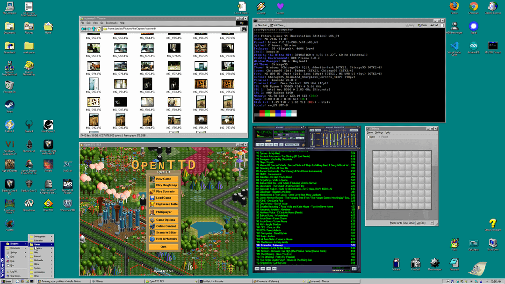
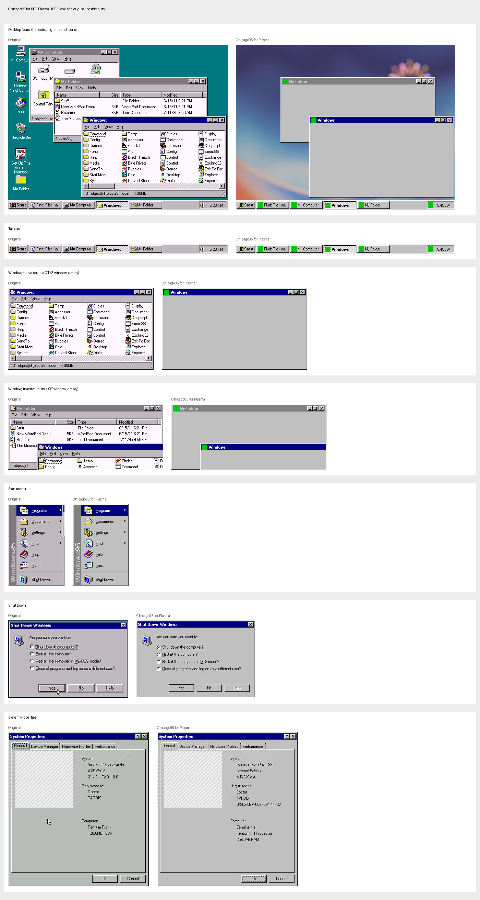
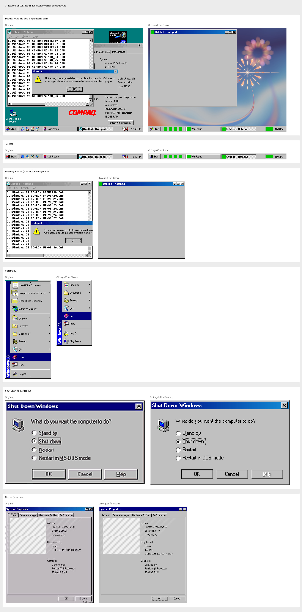
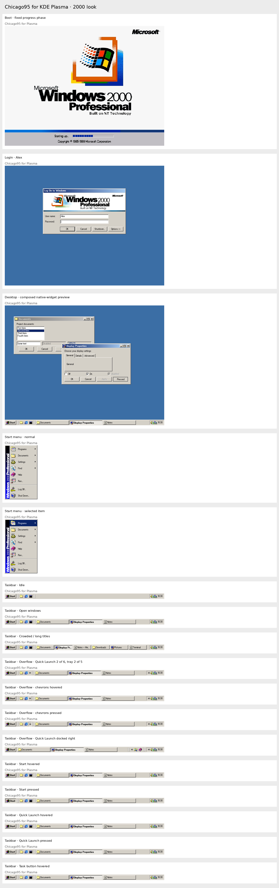

# chicago95-plasma

A classic desktop for KDE Plasma 6, inspired by Windows 95, pixel for pixel, on Wayland.



This repository holds everything Plasma-specific that sits on top of
[Chicago95](https://github.com/grassmunk/Chicago95): a generated Aurorae
window decoration, a generated Plasma style, three taskbar plasmoids, a
cascading Start menu, a classic notification daemon, Clippy, the Shut Down
dialog, a screensaver runner, and the configuration that ties it together.

The long-form write-up of how and why each piece works is the tutorial that
accompanies this repository. The README is the map; the tutorial is the
territory.

Built and tested on Fedora 44, Plasma 6.8.2 (Wayland), 3840x2160 at 1.5x.

## The three looks beside the originals

Setup offers three looks. Each picture shows an original screenshot (left) beside ours (right),
component by component: the desktop, the taskbar, the windows, the Start menu, the Shut Down dialog, and
for the 2000 look the loading and log-on screens. Ours is the real desktop, run headless by the tests:
its windows are empty test programs and its icons green test squares. The texts are set to the
originals' wording for the comparison. The pictures are made by `tests/render_report.py` (see Tests).

### 1995 look



### 1998 look



### 2000 look



## Layout

| Folder                 | Contents                                                                                                                                                                                                                                        |
| ---------------------- | ----------------------------------------------------------------------------------------------------------------------------------------------------------------------------------------------------------------------------------------------- |
| `aurorae/`             | `make_chicago95_aurorae.py`, `bevel.py`, Start button images, and the generated theme under `theme/`                                                                                                                                            |
| `plasma-style/`        | `make_chicago95_plasmastyle.py` and the generated style under `theme/`                                                                                                                                                                          |
| `plasmoids/`           | `org.chicago95.start`, `org.chicago95.tasks` (Quick Launch and task buttons), `org.chicago95.trayframe`, `org.chicago95.clock`                                                                                                                  |
| `bin/`                 | `chicago95-startmenu`, `chicago95-notifyd`, `chicago95-clippy`, `chicago95-shutdown`, `chicago95-screensaver`, `chicago95-sysprops`, `chicago95-devmgr`, `chicago95-dialup`, `chicago95-deezer`, `chicago95-control-panel`, `chicago95-askpass` |
| `lib/`                 | `chicago95ui.py`, the shared PySide6 look module                                                                                                                                                                                                |
| `data/`                | Menu stylesheet for plasmashell, tray arrow, Clippy sprites and sounds, KRunner QML override, fastfetch preset                                                                                                                                  |
| `data/sound-themes/`   | Freedesktop sound themes for Windows 98, the 16 Plus! 98 schemes and Windows 2000, built by `setup/make_sound_themes.py`                                                                                                                        |
| `data/toolbar-icons/`  | Windows 95 and 2000 Explorer toolbar buttons (Back, Up, Cut, Copy...), installed as the `Chicago95-Toolbar` icon theme over the look's icon set; built by `setup/make_toolbar_icons.py`                                                         |
| `config/`              | Colour scheme, KWin rules, systemd drop-in and unit, environment.d, autostart entries, Thunar, xsettingsd, GTK CSS, Dolphin toolbar, Firefox `user.js`                                                                                          |
| `kwin-effects/`        | `chicago95notifications`, the slide-in effect                                                                                                                                                                                                   |
| `lockscreen/`          | The `contents/lockscreen` override for the Plasma desktop shell                                                                                                                                                                                 |
| `splash/`              | `chicago95.splashscreen` KSplash package                                                                                                                                                                                                        |
| `install.sh`, `setup/` | Chicago95 Setup: detection, component and option screens, install steps                                                                                                                                                                         |
| `uninstall.sh`         | Removes what Setup installed and restores backups                                                                                                                                                                                               |

## Requirements

KDE Plasma 6 and `git`. Setup handles the rest:

- It clones [grassmunk/Chicago95](https://github.com/grassmunk/Chicago95) to
  `~/src/Chicago95` when no checkout is found (themes, icons, cursors, sounds
  and the More Perfect DOS VGA font come from it). Point `CHICAGO95_SRC` at an
  existing checkout to reuse it.
- When Python modules are missing it shows the package command for your
  distribution and offers to run it with `sudo`. On Fedora that is:

```
sudo dnf install python3-pyside6 python3-pyxdg python3-dbus python3-gobject \
    thunar xsettingsd tumbler qmmp qmmp-plugin-pack \
    xscreensaver-extras xscreensaver-gl-extras
```

The MS W98 UI font can't be redistributed. Drop the OTF into
`~/.local/share/fonts` before running Setup, or pick another family with
`--font=`.

## Install

```
git clone https://github.com/gedaiu/chicago95-plasma ~/src/chicago95-plasma
cd ~/src/chicago95-plasma
./install.sh
```

Setup runs as a full-screen text installer in the classic
style: it collects information about the computer, lets you pick
components and options, copies files with a progress bar, and reloads
Plasma.

It detects the distribution and package manager, the Plasma version, the
primary screen's logical resolution and scale, an existing Chicago95
checkout (or clones one), the XScreenSaver hack directory, the Firefox
profile in daily use, whether Thunar and qmmp are installed, and missing
Python modules, with the install command for your distribution.

Components, each optional: Chicago95 base theme, decoration and Plasma
style, taskbar plasmoids, Start menu and Shut Down dialog, notifications,
Office Assistant, extra tools, Control Panel, sound scheme, desktop background, screensaver, Winamp, Explorer (Thunar or
Dolphin), lock screen, splash screen, boot screen (Plymouth), login screen
(SDDM), Firefox colours.

Selections are the selection colour under white text everywhere: drop-down
rows, selected desktop icons and KRunner's current result (its results view is
a QML override under `data/qml`, loaded ahead of Plasma's through
`QML_IMPORT_PATH`); a row that is only under the pointer keeps black text and
gets an outline instead.

Toolbar icons in every program are grey until the pointer is over them, as
Explorer's were: KDE's icon effects for Qt programs, a GTK CSS rule for the
rest, and for Plasma's own buttons (KRunner, the tray's popups, widgets) one
file of Plasma's components module shadowed under `data/qml`; Setup links the
rest of that module from the system's copy.

Setup remembers: the components and choices of earlier runs are the defaults
of the next one (flags and the screens still change them), so a reinstall or
an update keeps your set-up with a few ENTERs.

Options are pre-filled from detection and editable on the Setup Options
screen or as flags:

| Flag                                 | Default                         | Effect                                                                                                                                                                                                                                                                                                                                                                                                                                                                                                                                 |
| ------------------------------------ | ------------------------------- | -------------------------------------------------------------------------------------------------------------------------------------------------------------------------------------------------------------------------------------------------------------------------------------------------------------------------------------------------------------------------------------------------------------------------------------------------------------------------------------------------------------------------------------- |
| `--screen=WxH@scale`                 | detected                        | Positions of Start menu, Clippy, notifications; X11 DPI                                                                                                                                                                                                                                                                                                                                                                                                                                                                                |
| `--panel=28`                         | 28                              | Taskbar height used in the window rules                                                                                                                                                                                                                                                                                                                                                                                                                                                                                                |
| `--explorer=thunar` or `dolphin`     | Thunar if installed             | Which file manager gets the Explorer setup                                                                                                                                                                                                                                                                                                                                                                                                                                                                                             |
| `--saver=deepstars`                  | deepstars                       | Screensaver, also chosen and previewed on its own Setup screen                                                                                                                                                                                                                                                                                                                                                                                                                                                                         |
| `--idle=5`                           | 5                               | Minutes before the screensaver starts                                                                                                                                                                                                                                                                                                                                                                                                                                                                                                  |
| `--cursor=48`                        | 48 at fractional scale, else 32 | Cursor size                                                                                                                                                                                                                                                                                                                                                                                                                                                                                                                            |
| `--clippy=yes` or `no`               | yes                             | Start the Office Assistant at login                                                                                                                                                                                                                                                                                                                                                                                                                                                                                                    |
| `--quick-launch=yes`, `no` or `auto` | auto                            | Show the Quick Launch (program shortcuts beside Start) on the taskbar; auto shows it from the 1998 look on, as the originals did. Right-click a task to add its program, right-click a shortcut to remove it, or drop programs on it. Drag the separator at its docked edge to carry it to the other end of the taskbar, beside Start or before the tray; drag the separator facing the task buttons to size it, and a chevron lists the shortcuts that do not fit. Drag a task button or a shortcut along the taskbar to reorder them |
| `--task-button-width=160`            | the look's own                  | Longest a window's button on the taskbar may be, in pixels                                                                                                                                                                                                                                                                                                                                                                                                                                                                             |
| `--settings=FILE`                    | none                            | Choices saved by the Control Panel (`KEY=value` lines, never executed), applied over the defaults; Setup saves its own choices to `~/.config/chicago95/setup.conf`                                                                                                                                                                                                                                                                                                                                                                     |
| `--font="MS W98 UI"`                 | MS W98 UI                       | UI font family, applied if installed                                                                                                                                                                                                                                                                                                                                                                                                                                                                                                   |
| `--font-scope=everywhere`            | everywhere                      | Where the UI font goes: `everywhere` (all programs, also web pages that ask for the system font), `desktop` (window title bars only) or `none`; Setup asks when the flag is missing. The Start menu, notifications, Clippy, Shut Down and the login screen always use it                                                                                                                                                                                                                                                               |

### Control Panel

`chicago95-control-panel` (Start, Settings, Control Panel; or Properties in the
right-click menu of the Start button and the taskbar) is one Windows 98
Explorer-style window for every choice Setup asked and more: colours (swatches
that open a colour picker; + adds a gradient's second colour or a banner stop)
and icons, desktop background, screensaver with Preview, taskbar height and
button width with a preview of the buttons, auto hide, clock, Quick Launch
(drag shortcuts onto it, drag them off to remove), Start button and menu banner,
login and loading screen texts and pictures with live previews of the log-on
dialog, the 2000 banner and the loading screen, sounds with Play, fonts,
pointer size and the file manager. Back, Forward, Up and the clickable address
bar move between pages. One window: Properties on the taskbar brings the open
one back on its page. It saves `~/.config/chicago95/setup.conf` and runs
Setup again for only what changed. Its Updates page shows the installed
version (the commit Setup recorded) and the published one (one `git ls-remote`
of the repository's origin), with Check now and Install update, which pulls
the repository forward and reruns Setup for the saved settings. Clippy runs the
same check once a day after login and says so in a balloon when a newer version
is out; the answer is cached in `~/.cache/chicago95/update-check.json`.

Other modes: `--yes` takes every default without questions,
`--components base,look,taskbar` installs only those, `--dry-run` writes
nothing and logs every action, `--plain` replaces the full-screen UI with
plain output.

Setup starts with an intro screen, waits for ENTER (Next) on every page
and lists each file as it copies it. When Chicago95 is already installed it
offers Reinstall, Uninstall or Exit.

Every file Setup replaces is backed up to
`~/.local/share/chicago95/backup-<date>/`, and every file it writes is
listed in `~/.local/share/chicago95/installed-files.txt`. A reinstall adds
to that list and never backs up a file Setup wrote itself, so the backups
always hold your originals. `./uninstall.sh` reads the list, removes the
files and window rules, restores the oldest backup of each file and
switches Plasma back to Breeze. Window rules are merged into an existing
`~/.config/kwinrulesrc` as text, so your own rules are kept.

At the end Setup offers to replace your panels with the Chicago95 taskbar
(the old layout is backed up) and to log out, which the autostart entries
need. It does neither without a yes.

The screensaver runs from Plasma's power management
(`~/.config/powerdevilrc`, "Run script" after the idle time), because
Wayland does not give the idle time to ordinary programs. Any key, click or
mouse movement ends it.

The "Boot screen" and "Login screen" components ask for the administrator
password on the Setup screen and list the exact commands first. The boot
screen copies `~/src/Chicago95/Plymouth/Chicago95` and rebuilds the boot
image with `plymouth-set-default-theme -R`; with the 2000 log-on style it
instead renders our 2000 loading screen at the monitor's size
(`bin/chicago95-splash-image`) and installs it as `Chicago95-2000`, a
Plymouth script theme (`plymouth/Chicago95-2000`) that fills in the progress
blocks as the system boots. Uninstall switches back to the previous theme.

The "Login screen" component asks for the administrator password on the
Setup screen, installs the Chicago95 log on dialog from `sddm/Chicago95Plasma` (with the UI font, which the greeter cannot read from your home) and
writes `/etc/sddm.conf.d/zz-chicago95.conf`. SDDM reads that folder in name
order and the last file wins, so the `zz-` name beats a leftover theme
setting from another file there. Both are off with `--yes`; ask for them with
`--components=plymouth,sddm`.

## Resolution

Wayland does not let clients position their own windows, so the Start
menu, Clippy and the notification column are placed by KWin rules that
Setup computes from the screen size and taskbar height. After a
resolution change, rerun
`./install.sh --components startmenu,notifications,clippy`.

## Fractional scaling

At 1.5x the pixel font is crisp only at integer device sizes, which is why
the tools pin 10 px, and X11 apps need `Xft.dpi: 144` in `~/.Xresources`
and `forceFontDPI=144` in `~/.config/kcmfonts` with no `QT_SCALE_FACTOR`
anywhere. At 1x or 2x the DPI section of the tutorial can be skipped.

## Linting and formatting

`make check` verifies formatting and lints every source file without changing anything; CI runs it. `make format` rewrites the files into the house style.

| Files                               | Tools                                                                                                  |
| ----------------------------------- | ------------------------------------------------------------------------------------------------------ |
| Python, including `bin/chicago95-*` | ruff (settings in `pyproject.toml`, line length 120)                                                   |
| Shell                               | shfmt and shellcheck                                                                                   |
| QML                                 | qmlformat and qmllint, from `pyside6-*`                                                                |
| JS                                  | eslint with `@re-cinq/eslint-plugin-re-lint` (it also adds blank lines for readability), then prettier |
| JSON, YAML, CSS, Markdown           | prettier, run through `npx`                                                                            |
| XML, `.desktop`                     | xmllint, desktop-file-validate                                                                         |

`pip install --user -r requirements-dev.txt` brings ruff, shellcheck and shfmt, and `npm ci` the JavaScript tooling (`make` does that itself). A tool that is missing is skipped locally and is an error in CI. SVG files are generated and left alone. The KDE-derived `lockscreen/` and `data/qml/` QML is formatted but not linted, and qmllint only gates on every message when the Plasma QML modules are installed.

## Tests

```
pip install --user -r requirements-dev.txt
python3 -m pytest tests
```

`tests/test_startmenu_reference.py` renders the Start menu at 1x and compares it with a
screenshot of the 1995 original:
size, bevel, separator, highlight, arrows and text positions must match; outside the icons and
the letter shapes, not a pixel may differ. The screenshots are in `tests/references` (sources in `SOURCES.md` there).

`tests/test_plasma_taskbar_reference.py` and `tests/test_plasma_window_reference.py` run the real
desktop: Setup installs into a throwaway home, then KWin and plasmashell run headless at 640x480 with
each original's windows (Qt, GTK 3, GTK 4 and X11), Quick Launch entries and tray icons, and the
screenshot is compared with the original's taskbar and windows. They need KWin, plasmashell, spectacle,
Xwayland, xmessage and the MS W98 UI font, and are skipped without them; each look takes about 25 seconds.

`python3 tests/render_report.py docs/compare` writes, per OS:

- `showcase-<look>.jpg`, to show people: component by component (desktop, taskbar, windows, Start menu,
  Shut Down, System Properties, and on 2000 the loading and log-on screens), the original beside ours;
- `showcase-controls-<look>.jpg`: every control, rendered by `tests/controls_gallery.py` in the look's
  colours (push buttons in each state, check boxes, radio buttons, text fields, drop-downs, disabled
  drop-down and spin box, spin box, sliders, scroll bars including disabled and empty ones, progress bar,
  group box, tabs, list box, menu bar, tool bar buttons, the Explorer toolbar's buttons in each state,
  status bar, labels), each beside the same control cropped from an original screenshot where one shows
  it, then our own controls (title bar buttons, tabs, menu rows, the taskbar's parts);
- `report-<look>-<part>.png`: every detail the tests compare, the original, ours and their difference
  in red, enlarged, with a `.txt` listing how many pixels differ in each. The programs' content in the
  windows, icons and the clock's time are hatched alike in both; our banners carry the original's wording.

The taskbar and windows come from the real headless desktop when KWin and Plasma are installed; CI, which
has neither, draws them from our files and publishes the images as an artifact.

## Credits

Chicago95 by grassmunk and contributors (GPL-3.0) for the theme, icons,
cursors, sounds, Plymouth and SDDM themes. React Plus as the starting copy
for the Plasma style. ClippyJS for the Office Assistant sprite data.
Nullsoft's Winamp 2.91 base skin, played by qmmp. XScreenSaver by Jamie
Zawinski. The Windows 98, Plus! 98 and Windows 2000 (remastered) sound
schemes are Microsoft's; they are converted to Ogg for the sound themes.

## Licence

GPL-3.0, matching Chicago95, whose artwork the generated files derive from.
See `LICENSE`.
