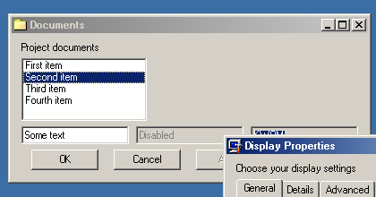
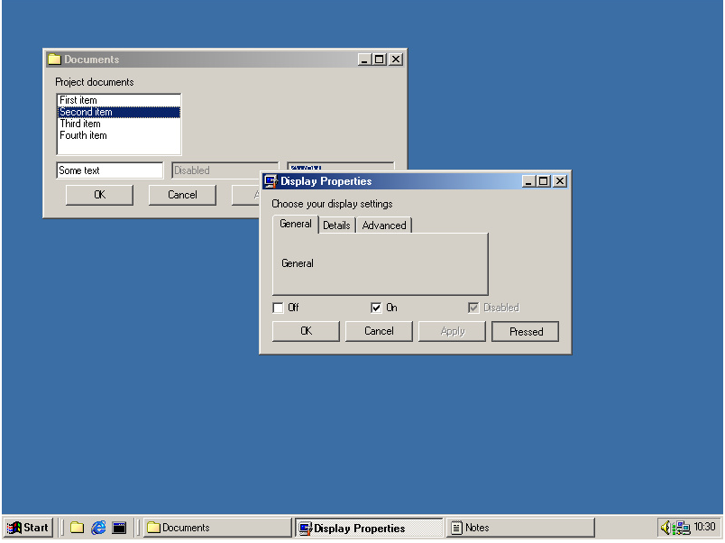
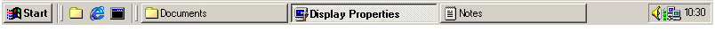
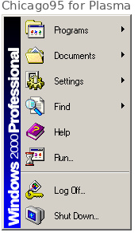

# Setting up Chicago95 by hand

This guide shows you how to install Chicago95 piece by piece, without the automatic installer. You choose which parts you want: maybe just the icons and the window borders, maybe everything.

**Not sure you want this?** The automatic installer (`./install.sh`) does all of these steps for you, asks before changing anything important, and can undo everything later with `./uninstall.sh`. If you only want the full look, use the installer instead. This guide is for when you want to pick parts yourself, or see exactly what goes where.

## Before you start

### You will type commands into a terminal

Every step gives you a few lines to copy into a **terminal**. That's the window where you type commands. In KDE Plasma, open the Start menu and search for **Konsole**.

To run a step:

1. Select the lines in the grey box and copy them (Ctrl+C).
2. Click in the terminal and paste them with **Ctrl+Shift+V**. In a terminal, Ctrl+V doesn't paste.
3. Press Enter if the last line hasn't run yet.

If a step works, it usually prints nothing at all. That's normal: no news is good news. If you see an error, stop there and read the "If something goes wrong" section at the end.

### Some steps ask for your password

Commands that start with `sudo` change files for the whole computer, such as the login screen and the boot screen. The terminal asks for your password. Nothing appears on screen while you type it; that's normal too. Type it and press Enter.

### Download the files (once)

Paste this into the terminal. It downloads this project and the original Chicago95 theme it builds on, then moves into the project's folder:

```
git clone https://github.com/gedaiu/chicago95-plasma
git clone --depth 1 https://github.com/grassmunk/Chicago95
cd chicago95-plasma
```

The download is about 100 MB. **All of the steps below expect the terminal to be in the `chicago95-plasma` folder.** If you close the terminal and come back later, open a new one and run `cd chicago95-plasma` first.

## What you can install

The parts are sorted from easiest to hardest. Start at the top and stop whenever you have enough.

| Part                                                        | Difficulty | What you get                                                                                |
| ----------------------------------------------------------- | ---------- | ------------------------------------------------------------------------------------------- |
| [1. The basic look](#1-the-basic-look)                      | Easy       | Icons, mouse pointers, sounds, window borders, colours, and the look of other programs      |
| [2. Fonts, taskbar and splash](#2-fonts-taskbar-and-splash) | Medium     | The classic font, the Windows-style taskbar, the loading screen and the classic boot screen |
| [3. Screens built for you](#3-screens-built-for-you)        | Hard       | The login screen, the 2000, 98 and XP boot screens, and the look of Firefox and Wine        |
| [4. The extra programs](#4-the-extra-programs)              | Hardest    | The Start menu, the Shut Down dialog, Windows-style notifications and the Control Panel     |

Parts 1 and 2 need only KDE Plasma 6. Parts 3 and 4 also need Python with PySide6; the README's Requirements section explains how to get them.

## 1. The basic look

Each step copies a theme into your home folder, then turns it on. You can also switch any of them back later in **System Settings > Colors & Themes**.

### Icons

What it changes: the pictures for folders, files and programs.

```
mkdir -p ~/.local/share/icons
cp -r ../Chicago95/Icons/Chicago95 ~/.local/share/icons/
```

Then open **System Settings > Colors & Themes > Icons** and click **Chicago95**.

### Mouse pointers

What it changes: the arrow, and the hourglass shown while programs load.

```
mkdir -p ~/.local/share/icons
cp -r ../Chicago95/Cursors/Chicago95_Animated_Hourglass_Cursors_HiDPI ~/.local/share/icons/
plasma-apply-cursortheme Chicago95_Animated_Hourglass_Cursors_HiDPI --size 32
```

The new pointer appears straight away.

### Sounds

What it changes: the start-up sound and the sounds for warnings and messages.

```
mkdir -p ~/.local/share/sounds
cp -r ../Chicago95/sounds/Chicago95 ~/.local/share/sounds/
cp -r data/sound-themes/* ~/.local/share/sounds/
kwriteconfig6 --file kdeglobals --group Sounds --key Theme Chicago95
```

You also get the Windows 98, Plus! and Windows 2000 sound sets. To use one of them, run the last line again with the set's folder name (see the list in `data/sound-themes`) in place of `Chicago95`.

### Window borders

What it changes: the title bar at the top of every window, with the classic minimize, maximize and close buttons.



```
mkdir -p ~/.local/share/aurorae/themes
cp -r aurorae/theme ~/.local/share/aurorae/themes/Chicago95
kwriteconfig6 --file kwinrc --group org.kde.kdecoration2 --key library org.kde.kwin.aurorae
kwriteconfig6 --file kwinrc --group org.kde.kdecoration2 --key theme __aurorae__svg__Chicago95
kwriteconfig6 --file kwinrc --group org.kde.kdecoration2 --key ButtonsOnLeft M
kwriteconfig6 --file kwinrc --group org.kde.kdecoration2 --key ButtonsOnRight IAX
qdbus6 org.kde.KWin /KWin reconfigure
```

Every open window changes at once.

**Want the Windows XP look instead?** Replace the second line with `cp -r luna/aurorae/theme ~/.local/share/aurorae/themes/Chicago95Luna`, and in the fourth line replace `__aurorae__svg__Chicago95` with `__aurorae__svg__Chicago95Luna`.

The title bars stay navy blue and grey. The automatic installer can also redraw them in your colour scheme's colours, but that uses one of the extra programs from part 4 (`bin/chicago95-sync-colors`).

### Desktop style

What it changes: the panels, pop-ups and desktop widgets.

```
mkdir -p ~/.local/share/plasma/desktoptheme
cp -r plasma-style/theme ~/.local/share/plasma/desktoptheme/Chicago95
plasma-apply-desktoptheme Chicago95
```

For the XP look, use `luna/plasma-style/theme` in the second line and name the copy `Chicago95Luna`, then apply `Chicago95Luna`.

### Colours

What it changes: the grey windows, the navy selections and the teal desktop colour.



```
mkdir -p ~/.local/share/color-schemes
cp config/Chicago95.colors ~/.local/share/color-schemes/
plasma-apply-colorscheme Chicago95
```

For the XP look, copy `luna/Luna.colors` instead, name it `Chicago95Luna.colors`, and apply `Chicago95Luna`.

### Other programs (GTK)

What it changes: programs that don't come from KDE, such as GIMP, Thunar or LibreOffice dialogs. They use a different toolkit, called GTK, with its own theme.

```
mkdir -p ~/.themes
cp -r ../Chicago95/Theme/Chicago95 ~/.themes/
for version in 3.0 4.0; do
  kwriteconfig6 --file ~/.config/gtk-$version/settings.ini --group Settings --key gtk-theme-name Chicago95
  kwriteconfig6 --file ~/.config/gtk-$version/settings.ini --group Settings --key gtk-overlay-scrolling false
done
```

Close and reopen a GTK program to see the change. For the XP look, copy `luna/gtk/Chicago95Luna` into `~/.themes/` and use `Chicago95Luna` in both `kwriteconfig6` lines.

These programs use the original Chicago95 grey. The automatic installer can also match them to your colour scheme with `lib/gtk_palette.py`. You don't need that.

### Alt+Tab window switcher

What it changes: the box that appears when you hold Alt and press Tab to switch windows.

```
mkdir -p ~/.local/share/kwin/tabbox
cp -r kwin-tabbox/chicago95 ~/.local/share/kwin/tabbox/
kwriteconfig6 --file kwinrc --group TabBox --key LayoutName chicago95
kwriteconfig6 --file kwinrc --group TabBox --key HighlightWindows false
qdbus6 org.kde.KWin /KWin reconfigure
```

Press Alt+Tab to try it.

## 2. Fonts, taskbar and splash

These steps change a few more settings, but they still only copy files and switch things on.

### The classic font

What it changes: the text in menus, buttons and title bars, in the sharp pixel font of the 90s.

This project can't include the font, for licence reasons. If you have `MSW98UI-Regular.otf`, put it in the `.local/share/fonts` folder in your home folder first. (Folders starting with a dot are hidden; press Ctrl+H in the file manager to show them.) Then:

```
mkdir -p ~/.config/fontconfig/conf.d
fc-cache -f ~/.local/share/fonts
cp config/fontconfig/60-chicago95-pixel-font.conf ~/.config/fontconfig/conf.d/
for key in font menuFont toolBarFont; do
  kwriteconfig6 --file kdeglobals --group General --key $key "MS W98 UI,9,-1,5,50,0,0,0,0,0"
done
kwriteconfig6 --file kdeglobals --group WM --key activeFont "MS W98 UI,8,-1,5,75,0,0,0,0,0"
```

Log out and back in to see the font everywhere.

**If your screen is scaled to 125% or 150%** (System Settings > Display), skip the third line. That line keeps the font's edges sharp, but at those sizes it makes the text look jagged.

### Classic buttons in KDE programs

What it changes: buttons, check boxes and scroll bars in KDE programs such as Dolphin and System Settings.

```
kwriteconfig6 --file kdeglobals --group KDE --key widgetStyle Windows
```

Programs you open after this get the classic buttons.

For the XP look you need an extra program called **Kvantum**, from your software centre. Copy `luna/kvantum/Chicago95Luna` into the `.config/Kvantum` folder in your home folder. Open **Kvantum Manager** and choose **Chicago95Luna**, then run the command above with `kvantum` in place of `Windows`.

### Classic boot screen

What it changes: the screen shown while the computer starts, before you log in.

This one changes system files, so it asks for your password:

```
sudo cp -r ../Chicago95/Plymouth/Chicago95 /usr/share/plymouth/themes/
sudo plymouth-set-default-theme -R Chicago95
```

The second line takes a minute or two and prints a lot of text. Wait until you can type again. You'll see the new boot screen the next time you restart.

If it says `plymouth-set-default-theme: command not found`, or you get a dark screen when you restart, install the **plymouth-plugin-script** package from your software centre and run both lines again.

For the Windows 2000, 98 or XP boot screens, see [part 3](#boot-screens-2000-98-and-xp).

### Loading screen

What it changes: the screen shown right after you log in, while the desktop loads.

```
mkdir -p ~/.local/share/plasma/look-and-feel
cp -r splash/chicago95.splashscreen ~/.local/share/plasma/look-and-feel/
```

The loading screen reads its texts from a small settings file. Create it with a text editor such as KWrite, and save it as `settings.js` in the `.local/share/plasma/look-and-feel/chicago95.splashscreen/contents/splash` folder in your home folder. Paste this into it, and change the words in quotes to whatever you like:

```
.pragma library
var style = "classic"
var brandText = "Chicago95"
var edition = "Professional"
var company = "KDE"
var loadingText = "Starting up..."
var footer = "Chicago95 for KDE Plasma"
```

For `style`, write `classic`, `2000` or `luna` (the XP look). Then choose the splash screen in **System Settings > Colors & Themes > Splash Screen**.

### Taskbar

What it changes: the panel at the bottom of the screen gets the Start button, the window buttons and the clock tray.



First copy the taskbar's pieces:

```
mkdir -p ~/.local/share/plasma/plasmoids ~/.local/share/kwin/scripts
cp -r plasmoids/org.chicago95.* ~/.local/share/plasma/plasmoids/
sed -i "s|@HOME@|$HOME|g" $(grep -rl @HOME@ ~/.local/share/plasma/plasmoids/org.chicago95.*)
cp -r kwin-scripts/chicago95windows ~/.local/share/kwin/scripts/
kwriteconfig6 --file kwinrc --group Plugins --key chicago95windowsEnabled true
```

Then put them on your screen. You can do it either way:

- **Gently:** right-click your panel, choose **Add Widgets**, and search for "Chicago95". Drag the pieces you want onto the panel.
- **All at once:** this command **removes all your panels** and builds the full Chicago95 taskbar in their place. Keep a copy of your panel layout first, so you can get it back:

  ```
  cp ~/.config/plasma-org.kde.plasma.desktop-appletsrc ~/panel-layout-backup
  qdbus6 org.kde.plasmashell /PlasmaShell org.kde.PlasmaShell.evaluateScript \
    "panels().forEach(panel => panel.remove()); $(cat plasmoids/panel-layout.js)"
  ```

The Start button only opens a menu once you've installed the Start menu from [part 4](#4-the-extra-programs).

## 3. Screens built for you

These parts can't just be copied. They're drawn to fit your screen size and your own name and logo, so each step first runs a small program from this project that draws the picture, then copies the result. They need Python with PySide6.

### Boot screens: 2000, 98 and XP

What it changes: the screen shown while the computer starts.

Each of these needs a background picture, drawn while you install it. If you copy the folder without drawing the picture, the boot screen stays dark. Each one asks for your password, and the last line takes a minute or two. You'll see the result the next time you restart.

**Windows 2000.** Change `1920x1080` to your screen's resolution, shown in **System Settings > Display**. If your screen is scaled to 200%, also change `--scale 1` to `--scale 2`.

```
build=$(mktemp -d)
cp -r plymouth/Chicago95-2000/. "$build"
cp -r splash/chicago95.splashscreen/contents/splash "$build/splash"
QT_QPA_PLATFORM=offscreen python3 bin/chicago95-splash-image --splash "$build/splash" \
  --size 1920x1080 --scale 1 --out "$build/screen.png"
rm -rf "$build/splash"
sudo cp -r "$build" /usr/share/plymouth/themes/Chicago95-2000
sudo plymouth-set-default-theme -R Chicago95-2000
```

**Windows 98.**

```
build=$(mktemp -d)
python3 setup/make_98_boot.py ../Chicago95/Plymouth/Chicago95 \
  splash/chicago95.splashscreen/contents/splash/images/windows98.png "$build"
sudo cp -r "$build" /usr/share/plymouth/themes/Chicago95-98
sudo plymouth-set-default-theme -R Chicago95-98
```

**Windows XP.** This one shows your own name and logo where Windows XP showed its own. Change the words in quotes, and replace `/path/to/logo.png` with a picture of your logo.

```
build=$(mktemp -d)
cp -r luna/plymouth/Chicago95-XP/. "$build"
QT_QPA_PLATFORM=offscreen python3 luna/plymouth/branded_logo.py --out "$build" \
  --name "Chicago95" --company "KDE" --edition "Professional" --logo /path/to/logo.png
sudo cp -r "$build" /usr/share/plymouth/themes/Chicago95-XP
sudo plymouth-set-default-theme -R Chicago95-XP
```

### Login screen

What it changes: the screen where you type your password after the computer starts.

```
sudo mkdir -p /etc/sddm.conf.d
sudo cp -r sddm/Chicago95Plasma /usr/share/sddm/themes/
sudo cp ~/.local/share/fonts/MSW98UI-Regular.otf /usr/share/sddm/themes/Chicago95Plasma/
printf '[Theme]\nCurrent=Chicago95Plasma\n' | sudo tee /etc/sddm.conf.d/zz-chicago95.conf
```

The third line copies the classic font to the login screen, which can't see your own fonts. Skip it if you don't have the font.

To change the login screen's texts, its size or its style (classic, 2000 or XP), edit its settings file:

```
sudo nano /usr/share/sddm/themes/Chicago95Plasma/theme.conf
```

Every setting has a short explanation above it. Save with Ctrl+O and Enter, then close with Ctrl+X. You'll see the login screen the next time you log out.

### Firefox

What it changes: Firefox's own buttons, check boxes and drop-down lists. Firefox draws these itself, so the other themes don't reach them.

First find your Firefox profile folder: type `about:profiles` in Firefox's address bar and press Enter. Next to **Root Directory**, click **Open Directory**, then copy the folder's path from the file manager's address bar. **Close Firefox** before you continue.

In the lines below, replace each `<profile>` with that path, keeping the quotes:

```
cat config/firefox-user.js >> "<profile>/user.js"
mkdir -p "<profile>/chrome"
PYTHONPATH=lib python3 lib/firefox_chrome.py "<profile>/chrome/chicago95-controls.css"
touch "<profile>/chrome/userChrome.css"
echo '@import url("chicago95-controls.css");' | cat - "<profile>/chrome/userChrome.css" > /tmp/userChrome.css
mv /tmp/userChrome.css "<profile>/chrome/userChrome.css"
```

Start Firefox again to see the change. If you change your colour scheme later, run the third line again so the buttons match.

### Windows programs (Wine)

What it changes: Windows programs you run with Wine. Their buttons and windows take your colours.

```
PYTHONPATH=lib python3 lib/wine_look.py /tmp/wine-look.reg
WINEPREFIX=~/.wine wine regedit /tmp/wine-look.reg
```

**If your screen is scaled** and Windows programs look tiny, this makes them bigger. 144 is right for 150%; use 120 for 125% or 192 for 200%:

```
WINEPREFIX=~/.wine wine reg add 'HKCU\Control Panel\Desktop' /v LogPixels /t REG_DWORD /d 144 /f
```

**Careful with games:** only use these on Wine's own folder (`~/.wine`). Don't point them at folders made by Lutris, Steam or other game launchers, because that can stop those games from starting.

## 4. The extra programs

The Start menu, the Shut Down dialog, the notification pop-ups and the Control Panel are programs written for this project. Installing them by hand means copying each program, telling the system how to start it, and setting a few window rules. **This is where the automatic installer really pays off.** To install only these, you can run it for just one part, for example `./install.sh --components=startmenu`.

If you'd still rather do it by hand, follow these steps in order.

### Shared files (needed by all of them)

```
mkdir -p ~/.local/lib/chicago95 ~/.local/bin ~/.config/environment.d
cp lib/*.py luna/lib/*.py ~/.local/lib/chicago95/
cp -r luna/lib/images ~/.local/lib/chicago95/
cp config/environment.d/chicago95.conf ~/.config/environment.d/
sed -i "s|@HOME@|$HOME|g" ~/.config/environment.d/chicago95.conf
```

Log out and back in after this step.

### Start menu and Shut Down dialog



```
mkdir -p ~/.local/share/applications ~/.config/autostart ~/.local/share/kwin/effects
cp bin/chicago95-startmenu bin/chicago95-shutdown bin/chicago95-run ~/.local/bin/
chmod +x ~/.local/bin/chicago95-{startmenu,shutdown,run}
cp config/applications/chicago95-{startmenu,shutdown,run}.desktop ~/.local/share/applications/
cp config/autostart/chicago95-startmenu.desktop ~/.config/autostart/
sed -i "s|@HOME@|$HOME|g" ~/.local/share/applications/chicago95-*.desktop ~/.config/autostart/chicago95-*.desktop
cp -r kwin-effects/chicago95shutdown ~/.local/share/kwin/effects/
kwriteconfig6 --file kwinrc --group Plugins --key chicago95shutdownEnabled true
```

The Start menu also needs a window rule, so it opens just above the taskbar instead of in the middle of the screen:

1. Open **System Settings > Window Management > Window Rules** and click **Add New**.
2. Next to **Window class**, choose **Exact match** and type `chicago95-startmenu`.
3. Click **Add Property** and add **Position**, **Keep above other windows**, **No titlebar and frame** and **Skip taskbar**. Set each to **Force**, and set the position to the bottom-left corner, just above your taskbar.

To open the menu with the Windows key, as on Windows, go to **System Settings > Shortcuts** and give the Start menu a shortcut.

### Windows-style notifications

What it changes: messages from programs pop up in the bottom-right corner in the classic style.

```
mkdir -p ~/.config/systemd/user ~/.local/share/kwin/effects
cp bin/chicago95-notifyd ~/.local/bin/ && chmod +x ~/.local/bin/chicago95-notifyd
cp config/systemd/chicago95-notifyd.service ~/.config/systemd/user/
cp -r kwin-effects/chicago95notifications ~/.local/share/kwin/effects/
systemctl --user daemon-reload
systemctl --user enable --now chicago95-notifyd.service
```

Add a window rule as for the Start menu, with the window class `chicago95-notifyd`. Put it in the bottom-right corner, kept above other windows, with no title bar.

### Control Panel

```
mkdir -p ~/.local/share/applications ~/.local/share/chicago95
cp bin/chicago95-control-panel bin/chicago95-askpass ~/.local/bin/
chmod +x ~/.local/bin/chicago95-{control-panel,askpass}
cp config/applications/chicago95-control-panel.desktop ~/.local/share/applications/
sed -i "s|@HOME@|$HOME|g" ~/.local/share/applications/chicago95-control-panel.desktop
cp -r data/control-panel data/screensaver-previews ~/.local/share/chicago95/
```

The Control Panel saves your choices by running the automatic installer for whatever you changed. So keep the `chicago95-plasma` folder; don't delete it.

## If something goes wrong

| What you see                                     | What it means and what to do                                                                                                            |
| ------------------------------------------------ | --------------------------------------------------------------------------------------------------------------------------------------- |
| `No such file or directory` on a `cp` line       | The terminal isn't in the project's folder. Run `cd chicago95-plasma` and paste the step again.                                         |
| `cannot stat '../Chicago95/...'`                 | The original Chicago95 theme wasn't downloaded next to this project. Repeat [Download the files](#download-the-files-once).             |
| `command not found`                              | A program is missing. Install the one the message names from your software centre, then run the step again.                             |
| `ModuleNotFoundError: No module named 'PySide6'` | Parts 3 and 4 need PySide6. See the README's Requirements section.                                                                      |
| The change doesn't show                          | Log out and back in. Some parts are only read when you log in.                                                                          |
| You want everything back the way it was          | Pick your old choices again in System Settings. A hand install keeps no record of what it changed, so it can't be undone automatically. |

## What this guide doesn't cover

- **Undoing it all at once.** The automatic installer remembers every change it makes, and `./uninstall.sh` reverses them. A hand install keeps no such record.
- **Other icon sets.** The installer can also download Windows 98, Windows 2000 and Windows XP icons. That step is `install_icon_pack` in `setup/steps.sh`.
- **The smaller extras**: the screensaver, Clippy, Winamp, the file manager choice, mouse settings and window animations. To see what the installer does for any of them, run `./install.sh --dry-run`. It changes nothing; it only lists what it would do.
