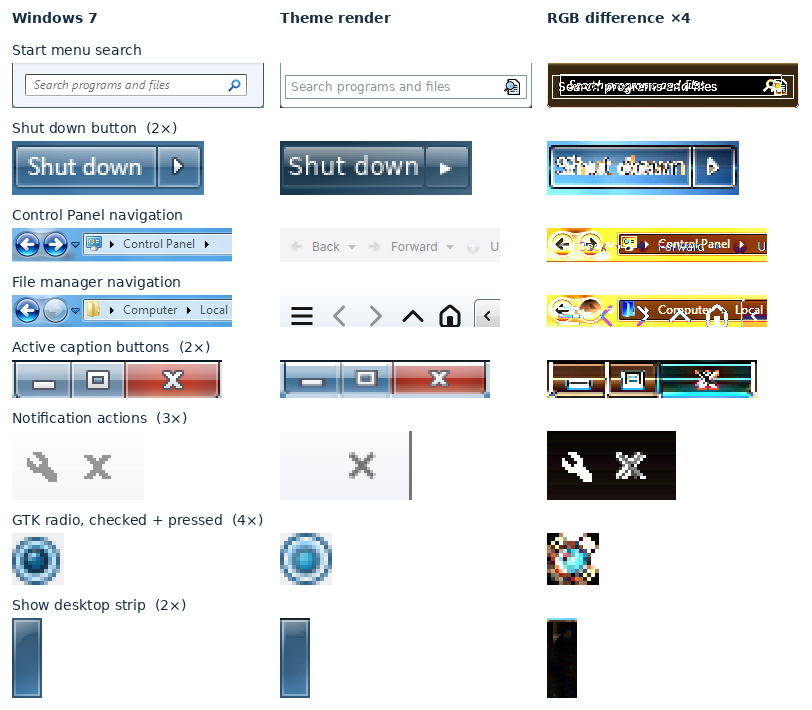

# Windows 7 Aero pixel audit

November 22, 2026. The theme differs visibly from Windows 7 in the Start menu, window captions, Control Panel and file-manager navigation. The empty superbar comes much closer. **109 of 118 audited RGB crops or sprite states differ by at least one pixel.** The unit of that count is a tested region or state. A one-level rounding difference and a redesigned toolbar each count once. Four additional tests compare layout proportions or control counts from published screenshots. [Current measurements for all 118 RGB comparisons](compare/report-aero-originals.csv)



## Window caption buttons

At 96 DPI, the minimize, maximize and close buttons occupy 20 painted rows. The last two rows are a dark outline and a bright highlight. The earlier theme compressed the face and glyph together into 18 rows. The revised decoration keeps the glyph at its native pixel size. The comparison uses the same regions and reference captures for both revisions.

| Region | Earlier mean RGB error (0–255) | Revised |
| --- | ---: | ---: |
| Active caption buttons | 31.32 | 18.17 |
| Inactive caption buttons | 19.52 | 14.88 |
| Active top-right corner | 34.68 | 27.26 |
| Inactive top-right corner | 18.12 | 16.96 |

The original audit crop ends above the bottom outline. An additional test samples all three buttons through the outline and highlight and checks their row positions in both focus states. The active glass around the buttons is still darker than the reference. [Windows 7, previous theme and revised theme at 2×](compare/aero-caption-buttons.png)

### Caption hover and focus timing

Three fresh 60 Hz trials per control from the Windows 7 SP1 VM show a fast hover entry and a slower fade on exit. The earlier decoration switched both instantly. The Aero caption now animates each button independently and draws the coloured halo beyond its edges. The live KWin test checks the halo's falloff against the original Close button. Custom groups containing additional KDE controls use Aurorae's standard renderer.

| Caption control | Windows hover entry | Revised entry | Windows hover exit | Revised exit |
| --- | ---: | ---: | ---: | ---: |
| Close | 16–33 ms | 33 ms | 117–150 ms | 130 ms |
| Maximize | 50–67 ms | 65 ms | 116–133 ms | 130 ms |
| Restore | 50–83 ms | 65 ms | 116–134 ms | 131 ms |
| Minimize | 50–84 ms | 65 ms | 117–133 ms | 131 ms |

Times measure the 10–90% change in displayed button RGB. The revised figures come from rendering the installed decoration's QML component with the project artwork. Both focus directions reached their final face in the first changed frame on both systems. The automated comparisons allow 25 ms for sampling hover transitions and require a visible intermediate frame. They do not measure input latency. [Native capture details and timestamps](../tests/references/SOURCES.md) · [Visual timing tests](../tests/aero/test_aero_caption_motion.py)

### Whole-window motion

Three trials followed Notepad from its original bounds to maximized or minimized and back. A clean installation of the Aero preset in nested KWin repeated those actions on a light Qt window of the same size. Both desktops were 1024 × 768. Times below measure the 10–90% RGB change across the workspace above the taskbar. A one-frame result means both thresholds crossed in the same displayed frame. [Windows 7, previous and revised filmstrips](compare/aero-window-motion.png) · [All 36 timings](compare/aero-window-motion.csv)

| Action | Windows 7 SP1 | Previous KWin Aero | Revised KWin Aero |
| --- | ---: | ---: | ---: |
| Maximize | One frame | 117–150 ms | One frame |
| Restore from maximized | One frame | 117–150 ms | One frame |
| Minimize to taskbar | 116–117 ms | 100–133 ms | 100–133 ms |
| Restore from taskbar | 33–50 ms | 100–133 ms | 33–50 ms |

The Windows window began shrinking and becoming transparent together. KWin's original Squash effect held the large, opaque window longer and accelerated at the end. The Aero minimize effect now fades and shrinks the window together and accelerates when restoring. The taskbar button's position determines the destination. Windows and Plasma had different taskbar layouts in these recordings. Display samples were about 17 ms apart on Windows and typically 17–33 ms apart during transitions on KWin. One KWin maximize-restore interval was 50 ms. The captures cannot establish sub-frame equality.

The Windows 7 theme selector and the installer's Aero animations preset apply the new motion. Explicit installer animation choices take precedence. The live test records real button clicks in nested KWin and compares the transitions with the saved SP1 frames. [Whole-window visual test](../tests/aero/test_aero_window_motion.py)

## Control Panel follow-up

The table under Initial measurements records the original audit. After the Control Panel revision, the same 220 × 34 navigation crop measured **31.87** levels of mean RGB error, down from **61.84**. The Aero shell now puts navigation, breadcrumbs and search on one row. Taskbar settings open in their own 398 × 424 client area. Visual tests compare its tabs and action buttons with the original at 100% and 150% scale. [Updated Control Panel](compare/aero-control-panel.png) · [Taskbar and Start Menu Properties](compare/aero-taskbar-properties.png)

### Category View

The Windows 7 preset now opens Control Panel in the eight-category layout. Category headings open the related installed applets. Task links open a specific applet or property tab. The Windows 7 reference shows another window covering the lower right, so the comparison below uses only the unobscured upper 780 × 300 pixels. At 100% and 150% the first heading in each column starts within five logical pixels of the original. The screen still differs in icon artwork, task-link text and row spacing. The links describe the settings available in this project. Opening a category now retains the native 199-pixel left sidebar. In Appearance and Personalization the first heading is within five logical pixels at both scales. The clear lower sidebar differs from the original by 0.90 levels of mean RGB error. [Original category page](../tests/references/win7-sp1-aero-category-detail.png) · [Current category page](compare/aero-appearance-category.png)

The navigation strip still differs at 7,402 of 7,480 pixels with mean channel error 31.87. Fonts, icons and glass rendering remain visible differences.

[Full current Category View](compare/aero-control-panel-category.png) · [Windows 7 reference and current renders at both scales](compare/aero-category-comparison.png)

## SP1 reference VM and layout corrections

A clean English Windows 7 Professional SP1 x86 installation provided native 800 × 600, 96-DPI captures of [Device Manager](../tests/references/win7-sp1-basic-device-manager.png) and [Control Panel](../tests/references/win7-sp1-basic-category.png). Device Manager has a menu and toolbar above the tree. A status bar runs along the bottom. The toolbar commands differ with selection. The project now tests the colours and heights of both command bands and checks that the tree extends across the area previously occupied by buttons. These two VM images use the Basic graphics driver.

Hovering a category highlights the whole group on Windows 7. The project now draws its pale blue outline and vertical gradient behind the icon and links. A visual test samples the top, middle and bottom against the [native hover capture](../tests/references/win7-sp1-category-hover.png) and checks that leaving restores the white background. In a 60 Hz Aero capture, the group reached its highlight colour in the first changed frame. Four displayed frames are checked against the live widget. The first category heading in each column also has a position check against the clean SP1 installation at both test scales.

The Run button positions, Advanced System Properties action row and six-window Alt+Tab bottom inset pass their original-layout comparisons after correction. The figures below describe the earlier renders. The five Start-menu RGB crops still differ after the search field, power menu and glass changes.

| Start menu sample | Earlier mean RGB error | Revised mean RGB error |
| --- | ---: | ---: |
| All Programs search well | 25.37 | 9.42 |
| Initial search well | 25.65 | 9.73 |
| Right-hand glass | 9.55 | 5.88 |
| Shut down split button | 43.30 | 22.68 |
| Shut down options menu | 28.69 | 18.70 |

## What the Aero VM confirmed

| Surface | Comparison with the installed theme |
| --- | --- |
| Device Manager | Windows 7 uses a toolbar above the tree and a status bar below it. The project's Aero view now puts commands there and tests their centres at two widths. The console tree, action pane, help and scan buttons use artwork drawn for this toolbar. Mean RGB error in the Aero toolbar crop fell from 28.16 to 16.82. Differences remain in 2,601 of its 3,910 pixels. [Original Device Manager](../tests/references/win7-sp1-aero-device-manager.png) · [Toolbar comparison](compare/aero-device-manager-toolbar.png) |
| Display Properties | All five project tabs fit without either scrollbar at 100% and 150% scale. The native Windows 7 Display applet opens Screen Resolution. The multi-tab project sheet retains settings for the other desktop styles. [Native Screen Resolution](compare/win7-sp1-screen-resolution.png) · [Project Appearance tab](compare/aero-display-appearance.png) |
| Taskbar settings | The icon-only Windows 7 taskbar hides its sizing controls and button-width preview. The properties sheet has separate comparisons for tab and action positions. [Native sheet](../tests/references/win7-sp1-aero-taskbar-properties.png) |
| Start and hover | In both keyboard and mouse captures, the white program pane is fully visible in the first frame in which it appears. The default theme now reproduces that change. The original orb took about 217 ms to go from 10% to 90% of its hover colour change. A rendered animation test compares the same area and allows three frames for sampling. [Start opening samples](../tests/references/win7-sp1-start-opening.png) · [Orb hover samples](../tests/references/win7-sp1-start-orb-hover.png) |
| Lock screen | The credential field now lands within two pixels of all four original bounds at both tested resolutions. Across its top edge and the adjoining background the mean RGB error is 1.85 at 1024 × 768 and 0.79 at 800 × 600. [Original locked session](../tests/references/win7-sp1-aero-lock.png) |
| Calendar | The 336 × 247 client, analog clock span and settings footer match their geometry or colour checks. The fixed rim crop still differs at 466 of 560 pixels. [Original calendar](../tests/references/win7-sp1-aero-calendar.png) |

## Shutdown from the desktop to power-off

The original spent about half a second showing only the desktop wallpaper after its windows closed. A brief black interval followed, then the blue screen showed **Logging off...** for one or two capture intervals before changing to **Shutting down...**. In Plasma, the panel stayed visible until the black handoff, and Plymouth opened directly on **Shutting down...**. [Side-by-side shutdown recording](compare/win7-sp1-shutdown-comparison.webm)

| Measurement | Windows 7 Professional SP1 | Fedora KDE 44 with revised Plymouth theme |
| --- | ---: | ---: |
| Final click to desktop disappearing | 1.03–1.20 s | 2.40–2.44 s |
| Black handoff before the first blue status screen | 0.20–0.23 s | 0.20 s |
| Final click to first blue status screen | 1.23–1.40 s | 2.60–2.63 s |
| Final click to “Shutting down...” | 1.30–1.47 s | 2.60–2.63 s |
| Time on the blue background, including both Windows captions | 1.20–3.67 s | 1.13–2.85 s |
| Median time for one spinner revolution in each trial | 0.834 s | 0.834–0.866 s |
| Final click to hypervisor-reported power-off | 2.52–4.95 s | 3.73–5.48 s |

The original 18-pose spinner was faster than the theme's earlier 15 fps setting (a nominal 1.20 s per revolution). Plymouth at 21 fps reproduced the Windows period to within one captured frame. The shutdown caption previously began at y=376 on the 1024 × 768 export. It now begins at y=326, the original position. Tests also check the 800 × 600 layout. The configured font affects the horizontal lettering bounds. [Caption and spinner comparison at native scale](compare/win7-sp1-shutdown-position.png)

Time zero is the final click on Shut down in the Windows Start menu or in the project's confirmation dialog. Each display was sampled against a monotonic clock at 30 Hz and 1024 × 768. Windows ran in the offline WDDM reference VM. Fedora ran in a disposable QEMU/KVM guest built from Fedora KDE 44 release 1.7, with the distribution's Plasma desktop, the project's shutdown command, the exported theme and the real Plymouth power-off service. No applications had unsaved work. Power-off was detected separately from screen colour. The first Windows trial recorded the final black frame without a hypervisor power-off timestamp. Fedora displayed the blue screen through the last sample in both final trials; one also contained a single dark frame during that screen. Three Windows trials and two final Fedora trials supply these ranges. Individual transitions are resolved to roughly one frame (33 ms). Service load, open applications and hardware can change the timings. The theme adds no timer to prolong shutdown. [Per-trial measurements in seconds](compare/win7-sp1-shutdown-timing.csv)

## GTK 3 and GTK 4 controls

Both toolkits now use the Aero faces for checkboxes, radio buttons, progress bars, tabs and disabled form controls. GTK 3 paints the scrollbar grips with orientation-specific CSS and uses grey artwork for disabled indicators. GTK 4 retains its Files header layout and toolbar-style caption buttons. At native scale the checked and mixed checkboxes match between the two toolkits in the visual tests. The checked, hovered radio differs by about 1.17 levels of mean absolute RGB error. These comparisons use the rendered widgets with the showcase margins removed. [Side-by-side toolkit renders](compare/aero-gtk-toolkit-controls.png)

## Initial measurements before the corrections

| Surface                    | Original versus theme                                                                                                                                                                                                                                                                                                                                                                                                                 |
| -------------------------- | ------------------------------------------------------------------------------------------------------------------------------------------------------------------------------------------------------------------------------------------------------------------------------------------------------------------------------------------------------------------------------------------------------------------------------------- |
| Start menu                 | The original search well has a larger inset, italic placeholder and a small magnifier. The test render has a wider field, upright placeholder and a different search glyph. In All Programs, 8,459 of 11,340 search-well pixels differ. The Shut down split button differs at all 2,592 sampled pixels, with mean channel error 43.30. All 11,025 pixels in a text-free stretch of the right-hand glass differ, with mean error 9.55. |
| Frames and blur            | The modeled active caption buttons differ at 1,903 of 1,995 pixels, with mean error 31.32. The active top-right corner averages 34.68 and the inactive buttons average 19.52. In the live striped-wallpaper test, the light-to-dark transition spans 6.88 px at rest and 6.66 px during a drag. The fitted Windows 7 reference spans 8.84 px.                                                                                         |
| Superbar                   | The empty panel between x=320 and x=799 differs at 17,381 of 19,200 pixels, yet averages **0.78** levels of error. The running-button edges average 1.12, the hidden-icons arrow 2.34, Show desktop 3.62 and the Start orb ring 4.44. The orb measurement excludes the branding, and the running-button measurement excludes the application icon.                                                                                    |
| Control Panel and Explorer | Windows 7 combines circular navigation arrows and breadcrumbs on glass. The project's Control Panel has labelled actions and a separate address row. Thunar has a menu button, chevrons and a home button. The two 1× navigation crops average 61.84 and 65.39 respectively.                                                                                                                                                          |
| Alt+Tab                    | With six previews at 160 px, the space below the thumbnail image occupies 20.2% of the panel height. Microsoft's six-preview illustration measures 10.8%, with about 2.7 percentage points of measurement uncertainty.                                                                                                                                                                                                                |
| Run and System Properties  | In Run, the first action starts at 33.9% of the client width against 27.3% in the Windows 7 figure. The other two actions also start farther right. The original Advanced System Properties sheet has OK, Cancel and Apply. The rendered sheet has OK and Cancel.                                                                                                                                                                     |
| GTK and Firefox            | All 15 tested GTK checkbox and radio states differ from the original sprites. A normal checkbox averages 5.60 levels of error and a checked, pressed radio averages 42.77. The fixed corners of both push-button states, both entry states, the horizontal progress track and both scroll-thumb orientations also differ. Firefox's button is much closer. Its 10 × 21 left edge averages 2.44.                                       |
| Notification balloon       | Microsoft's Windows Update example shows a wrench beside Close. The rendered file-completion balloon has a single Close control in this corner. The 44 × 23 action crop averages 13.89 levels of error. Sender content and the balloon tail are outside the crop.                                                                                                                                                                     |

The nine exact matches are the sampled plain blue wallpaper, four grouped-task stack sprites, and the middle caption-button face in normal and disabled states on active and inactive glass. Those face tests exclude the glyph. Separately, the boot test reproduces both lettering crops of the supplied 1080p video frame exactly. In the 4:3 sign-in comparison, the password field centres at 63.87% of screen height against 63.86% in the published figure.

Windows XP offered both Category View and Classic View. The latter exposed applets directly, including the older Display Properties. [Microsoft’s Control Panel history](https://download.microsoft.com/download/9/a/3/9a36304d-cb64-427e-a184-4ed1bb556712/win7_sbs_earlycontent_ch1.pdf) · [Microsoft’s XP applet testing guide](https://learn.microsoft.com/en-us/previous-versions/windows/desktop/dnacc/testing-assistive-technology-for-compatibility-with-microsoft-windows-xp)

## Scope across the installer

| Installer component | Visual evidence and coverage limit                                                                                                                                                                                                                                      |
| ------------------- | ----------------------------------------------------------------------------------------------------------------------------------------------------------------------------------------------------------------------------------------------------------------------- |
| Base                | GTK indicators and selected widget corners have Microsoft sprite comparisons. The icon collection, aliases and cursor frames are rendered against their imported source packs.                                                                                          |
| Look                | Active and inactive Aurorae frames, button faces and glyphs have original comparisons. The 117 embedded Kvantum controls have source-art comparisons. Font substitution and application layouts can still change the result.                                            |
| Animations          | Nested KWin captures cover stationary and moving glass. A source screenshot constrains blur width. The Start program pane, orb hover and Control Panel category highlight have frame comparisons from the Aero VM. Other transitions lack paired timing measurements.                                                                                         |
| Taskbar             | Nested Plasma covers the panel, orb, buttons, grouping, tray, clock, calendar, Peek and Jump Lists. The numeric original comparisons cover selected collapsed regions and sprites. The calendar flyout geometry and clock rim also have SP1 comparisons. Clock text, unlocked spacing and paging layout have partial coverage. |
| Start menu          | Original shell captures cover fixed chrome on the initial page, All Programs and the power menu. Search results, application identities and confirmations have project portraits and interaction tests.                                                                 |
| Notifications       | The original balloon action area, project portrait and dismissal/expiry tests cover appearance and behavior for the tested examples.                                                                                                                                    |
| Clippy              | The Office Assistant has its own original idle-frame and balloon comparisons. It is an optional Office component.                                                                                                                                                       |
| Extras              | Advanced System Properties and Run have original layout checks. The other System Properties pages have project portraits. Device Manager has native Basic and Aero client and toolbar checks. Other utilities still lack complete matched captures.                                                         |
| Control Panel       | Navigation, Category View layout, category hover and the Taskbar properties sheet have original comparisons. The Display sheet has two-scale fit checks. Project-specific settings have different content.                                                                                                                                    |
| Sounds              | The installer and sound-mapping tests cover this component. Sound playback has no pixel output.                                                                                                                                                                         |
| Background          | The plain blue reference matched exactly. Stock wallpaper selection, image scaling and custom wallpapers are separate cases.                                                                                                                                            |
| Desktop             | Desktop tests cover shortcut configuration and destinations. Icon-pack tests cover artwork. A desktop with matching shortcuts and label rasterization remains unverified.                                                                                               |
| Switcher            | A six-window render has a proportional comparison against Microsoft's Windows Flip illustration. The reduced source supports layout measurements only.                                                                                                                  |
| Screensaver         | Selection and invocation of XScreenSaver hacks have behavior tests. Animation frames lack a matching stock Windows 7 reference for the selected hack.                                                                                                                   |
| Winamp              | The optional qmmp integration has sizing and docking tests. Its application skin has no stock Windows 7 counterpart.                                                                                                                                                    |
| Explorer            | The Aero-configured Thunar toolbar has a Windows Explorer comparison. GTK Files has separate visual tests. A complete Dolphin or Thunar window with matching folder contents remains unverified.                                                                        |
| Mouse               | Converted cursors have source-art comparisons, hotspot checks and animation-frame checks. Button mapping, acceleration and double-click timing are behavioral.                                                                                                          |
| Lock screen         | The actual lock QML is rendered with simulated authentication. Portrait, submit, failure and switch-user states have artwork or placement checks. Native full-screen lock captures at two resolutions constrain the password field. The complete backdrop and account artwork are outside the field comparison.                                                                  |
| Splash              | Welcome and the session spinner have rendered-frame and source-art checks. The session handoff lacks a synchronized Windows sequence.                                                                                                                                   |
| Plymouth            | Boot lettering has the two exact video crops. Animation tests cover frames and timing, and export tests check preview parity. VM recordings cover desktop teardown, the shutdown screen and power-off. Physical display and firmware behaviour remain unmeasured.                                                        |
| SDDM                | The sign-in field position matches the published 4:3 layout within measurement uncertainty. Login controls and failure states have separate source-art and QML checks. Full-screen RGB fidelity remains unverified.                                                     |
| Firefox             | Headless Firefox renders a fixture using the stylesheet installed by Setup. The left button edge has a native Windows control reference. Whole browser chrome is outside this comparison.                                                                               |

## Reproduce

From the repository root on a Plasma development machine with the [Aero reference assets](../aero/README.md), run both commands. The second returns a failure for each tested original-pixel mismatch or layout discrepancy. Use a fresh pytest temporary directory if retaining multiple runs.

```sh
python3 tests/aero/run_visuals.py
python3 tests/aero/run_visuals.py --exact-originals --junitxml=/tmp/windows7-pixels.xml
```

RGB comparisons use the mean absolute error across the three 8-bit channels. One unequal channel marks a changed pixel. Failed RGB tests save a triptych under the reported pytest path. The difference panel multiplies absolute channel errors by four for visibility. Inputs are unscaled 96-DPI crops and composited theme sprites. Published, reduced, or JPEG figures contribute only to the four layout tests. [Reference provenance](../tests/references/SOURCES.md) · [Audit tests](../tests/aero/audit_desktop_pixels.py)

The Start and balloon renders use the existing deterministic Fusion, DejaVu Sans and sample-icon fixture. Their glass, dimensions and placement are measurable, while different installed fonts and icon themes can change text and glyphs. The panel captures use an isolated nested Plasma session, the frames use the Aurorae layout model, and the file manager runs inside an isolated KWin session. [Portrait harness](../tests/aero/render_aero_dialogs.py) · [Frame harness](../tests/aero/test_aero_window_reference.py)

All **402 tests** currently collected by the normal visual runner passed across two runs, with zero skips. The full suite passed its 400 cases, and the applet rerun covered the two subsequently added category-detail scale cases. A separate applet, installer, theme and sound run passed **381 cases**. The tests overlap. These counts include behavior, project baselines and imported-art checks. The 118 zero-tolerance original-image comparisons are reported separately in the CSV.
